# Hospital Management System (HMS)

Cloud-native, event-driven hospital platform on **Spring Boot 3.3 / Java 21**, designed for AWS (Route 53, CloudFront, WAF, Shield, ALB, EKS, RDS, MSK).
Repository: <https://github.com/coder-stat920715/hms-platform>

> **Honesty note: read first.** This code base was written without a Java build environment. **It has not been compiled or run.**
> Checked mechanically: package/path agreement, balanced braces, `com.hms.*` imports, HCL/YAML/JSON syntax. Expect to fix a few compile errors
> on the first `mvn clean package` (use `-DskipTests` if a test blocks you). Terraform was never planned or applied.
> Every number labelled *target* below is a design goal to validate with load tests, **not a measured result**.
> Where the platform differs from what you might assume (no mTLS, no `@RetryableTopic`, no L2 Redis query cache) this document says so explicitly.

---

## Table of contents

1. [What the system does](#1-what-the-system-does)
2. [Architecture: HLD and LLD with the C4 model](#2-architecture-hld-and-lld-with-the-c4-model)
3. [Component deep dive (six parameters each)](#3-component-deep-dive-six-parameters-each)
4. [End-to-end workflow](#4-end-to-end-workflow)
5. [DNS, WAF, Shield and CDN configuration](#5-dns-waf-shield-and-cdn-configuration)
6. [Terraform guide](#6-terraform-guide)
7. [Kubernetes guide](#7-kubernetes-guide)
8. [Run locally, step by step](#8-run-locally-step-by-step)
9. [Testing guide](#9-testing-guide)
10. [Design patterns used](#10-design-patterns-used)
11. [Pattern implementations in detail](#11-pattern-implementations-in-detail)
12. [Transactional Outbox vs Debezium CDC (FAQ)](#12-transactional-outbox-vs-debezium-cdc-faq)
13. [Failure scenarios and compensation flows](#13-failure-scenarios-and-compensation-flows)
14. [Known gaps, roadmap and troubleshooting](#14-known-gaps-roadmap-and-troubleshooting)
15. [Repository layout](#15-repository-layout)

---

## 1. What the system does

HMS lets reception staff, doctors, nurses, billing clerks, pharmacists and patients work with:

| Capability | Where it lives |
|---|---|
| Register patients, keep contact data and an encrypted national ID, manage a care team and record sensitivity (`NORMAL`, `RESTRICTED`, `VIP`) | `patient-service` |
| Publish doctor availability (slots) and **book appointments** | `appointment-service` |
| Issue invoices after an insurance eligibility check, void them when a booking fails | `billing-service` |
| Reserve prescribed drugs, release them when a booking fails, alert on low stock | `pharmacy-inventory-service` |
| Tell patients the outcome (email, SMS, push) | `notification-service` |
| Authenticate users and authorise every call | Keycloak / Cognito + JWT validation in the gateway and in every service |

**The central business transaction is booking an appointment.** It spans three databases (appointment, billing, pharmacy), so it is implemented as an
**orchestrated Saga** with compensation, using the **Transactional Outbox** and **Debezium CDC** so no event is ever lost or invented.

### Naming map (if you are comparing with other reference architectures)

Some reference write-ups use `order-command`, `order-query` and `payment`. In HMS the equivalents are:

| Generic name | HMS equivalent | Note |
|---|---|---|
| order-command | `appointment-service` (write side + saga orchestrator) | Writes PostgreSQL `appointment`, `slot`, `appointment_saga`, `outbox` |
| order-query | `appointment-service` (read side: projector + `/search`) | Same deployable, separate code path; reads only MongoDB |
| payment | `billing-service` (+ `pharmacy-inventory-service` as a second saga participant) | Billing decides "invoice created / failed" |
| `order-events`, `payment-events` | `hms.appointment.events`, `hms.billing.events`, `hms.pharmacy.events` | Plus command topics `hms.billing-commands.events`, `hms.pharmacy-commands.events` |
| `payment-events.DLT` | `<topic>.DLT` (for example `hms.billing-commands.events.DLT`) | Produced by `DefaultErrorHandler`, **not** `@RetryableTopic` |

---

## 2. Architecture: HLD and LLD with the C4 model

The C4 model describes one system at four zoom levels. **HLD** (high-level design) is Levels 1 and 2. **LLD** (low-level design) is Levels 3 and 4 plus the data and event catalogues that follow.

| C4 level | Question it answers | Section |
|---|---|---|
| **1. System Context** | Who uses HMS and what does it depend on? | 2.1 |
| **2. Container** | Which deployable units and data stores exist, and how do they talk? | 2.2 |
| **3. Component** | What are the main building blocks inside one container? | 2.3 |
| **4. Code** | Which classes, tables and sequences implement it? | 2.4 |

### 2.0 Architectural principles

1. **Database per service.** No service reads another service's tables. Integration is by events and commands over Kafka.
2. **No dual writes.** A state change and its outgoing message are committed in one local transaction (outbox); a separate relay (Debezium) publishes it.
3. **At-least-once everywhere, idempotent consumers everywhere.** Duplicates are expected and harmless (`processed_message`).
4. **Zero trust.** The gateway validates the JWT, and **each service validates it again**. Network position is never the only control.
5. **Fail closed.** Missing resource, unknown role or unparsable claim means *deny*.
6. **Compensate, don't roll back.** Cross-service failure is undone by business-level compensating actions (void invoice, release slot, release stock).
7. **Everything observable.** Health probes, Prometheus metrics, a dedicated `hms.audit` log for every patient-access decision.

### 2.1 C4 Level 1: System Context

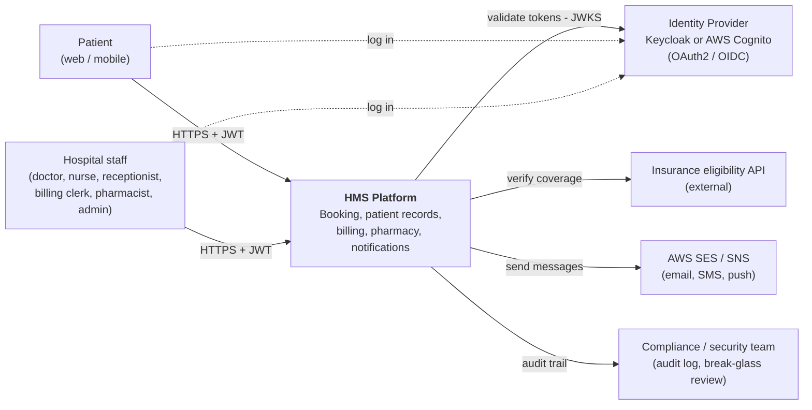

### 2.2 C4 Level 2: Container diagram

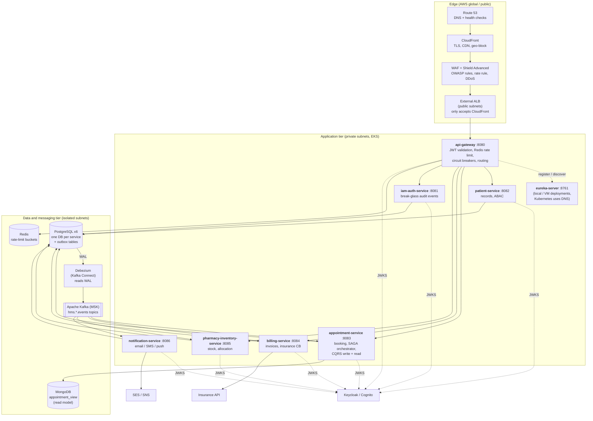

**Reading the diagram:** solid lines are synchronous calls or data flow; dotted lines are discovery or token-key fetches. All inter-service business traffic that changes state goes through **Kafka**, not through REST calls between services.

### 2.3 C4 Level 3: Component diagrams

#### 2.3.1 `appointment-service` (the most complex container)

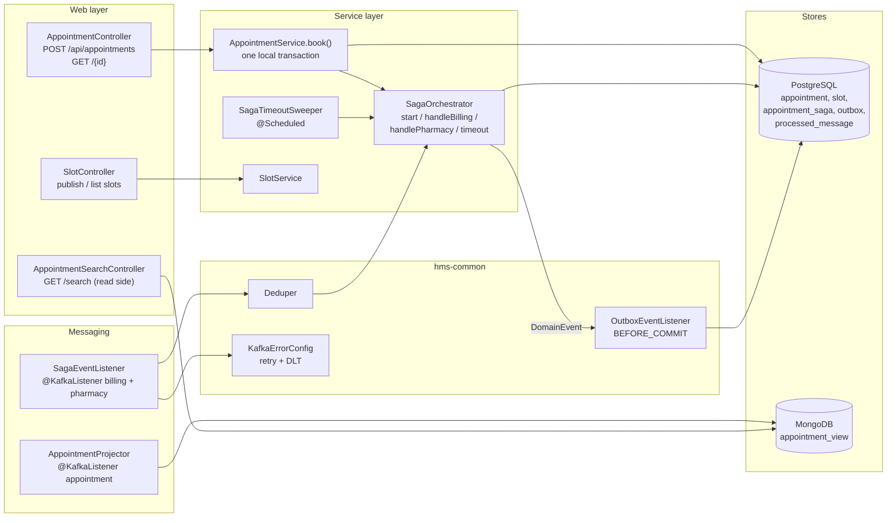

#### 2.3.2 `patient-service` security components (ABAC)

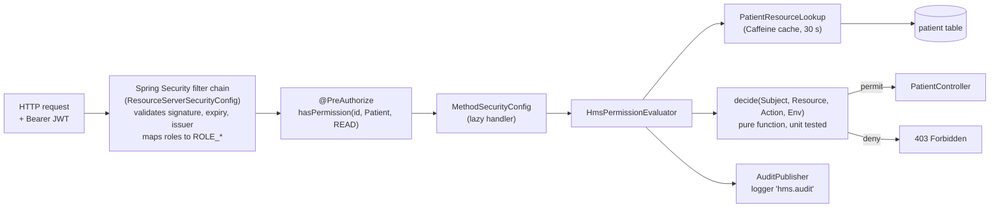

### 2.4 C4 Level 4: Code level

#### 2.4.1 Core classes and relationships

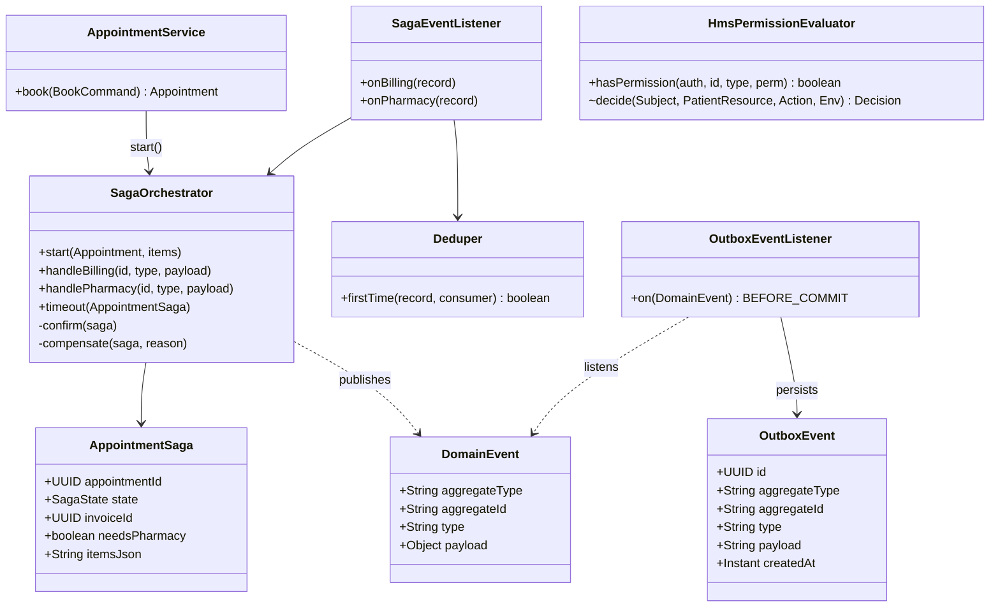

#### 2.4.2 Saga state machine

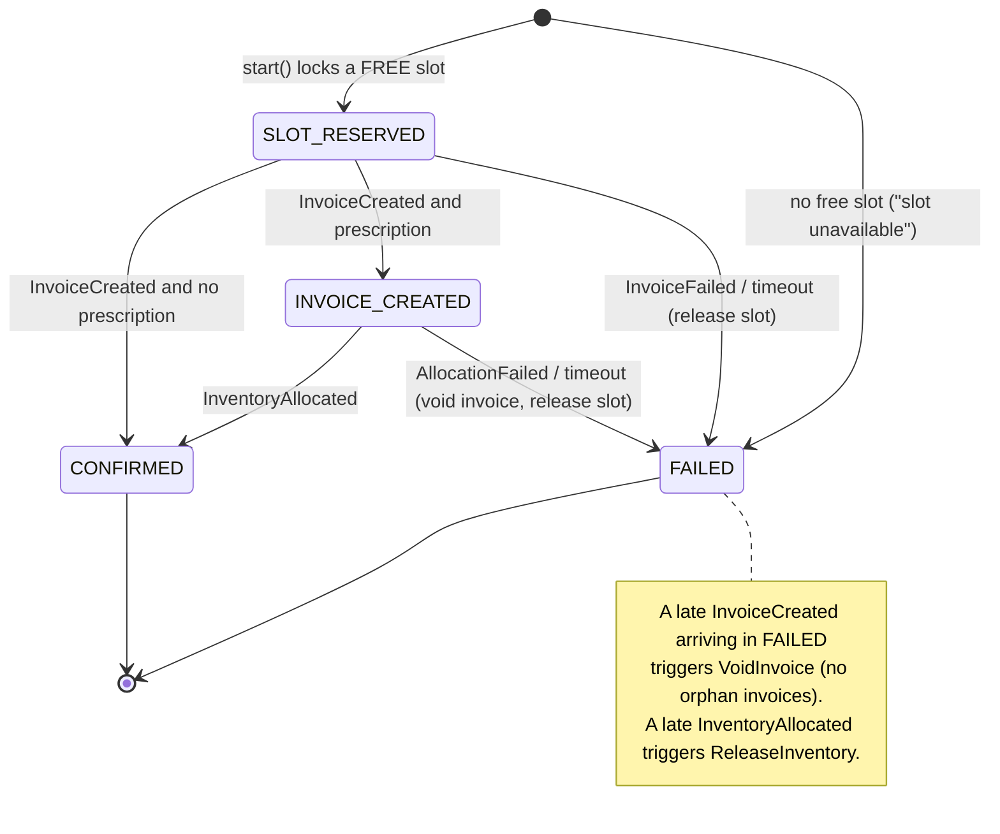

#### 2.4.3 Sequence: booking with a prescription (happy path)

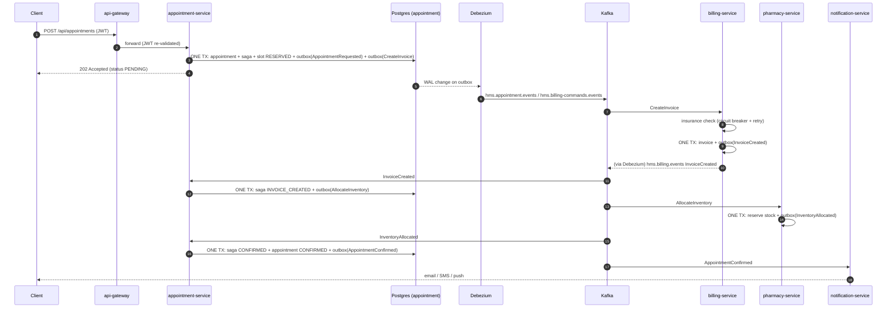

### 2.5 LLD: data model per service

All schemas are created by Flyway (`src/main/resources/db/migration/V1__init.sql`). Hibernate runs with `ddl-auto: validate`.

| Service / database | Tables | Notes |
|---|---|---|
| **All six databases** | `outbox(id, aggregatetype, aggregateid, type, payload TEXT, created_at)`, `processed_message(dedupe_key PK, processed_at)` | `outbox` has `REPLICA IDENTITY FULL` and publication `dbz_outbox`. `dedupe_key = <consumer>:<messageId>` |
| `patient` | `patient(id, national_id (AES-GCM ciphertext), full_name, date_of_birth, department, sensitivity, email, phone, locale, channels, push_endpoint_arn, version)`, `patient_care_team(patient_id, user_id)` | `national_id` encrypted by `EncryptedStringConverter` |
| `appointment` | `appointment(id, patient_id, doctor_id, slot_start, fee, status, failure_reason, created_at, version)`, `slot(id, doctor_id, start_time, end_time, status, appointment_id, version, UNIQUE(doctor_id,start_time))`, `appointment_saga(appointment_id PK, state, invoice_id, needs_pharmacy, items_json, failure_reason, created_at, updated_at, version)` | Index `(state, updated_at)` serves the timeout sweeper |
| `billing` | `invoice(id, appointment_id UNIQUE, patient_id, amount, status, created_at, version)` | `UNIQUE(appointment_id)` makes invoice creation idempotent |
| `pharmacy` | `drug_stock(drug_id, name, on_hand, reserved, reorder_at, low_stock_alerted, version, CHECK reserved<=on_hand)`, `allocation(id, appointment_id, drug_id, quantity, status, UNIQUE(appointment_id,drug_id))` | `CHECK` constraints are a last line of defence against overselling |
| `notification` | `recipient(patient_id, full_name, email, phone, locale, channels, push_endpoint_arn, updated_at)` | Contact data only, no clinical data |
| `iam` | (outbox + processed_message only) | Stores no users; the IdP does |
| MongoDB `hms_read` | `appointment_view` (`id`, `patientId`, `doctorId`, `slot`, `status`, `failureReason`, `updatedAt`) | Indexed on patientId, doctorId, status |

### 2.6 LLD: event and command catalogue

Debezium's `EventRouter` routes an outbox row to the topic `hms.<aggregatetype>.events`, uses `aggregateid` as the Kafka key, and adds headers `eventType` and `messageId`.

| Topic | `aggregatetype` | Key | Event / command types | Producer (outbox owner) | Consumers (group) |
|---|---|---|---|---|---|
| `hms.appointment.events` | `appointment` | appointmentId | `AppointmentRequested`, `AppointmentConfirmed`, `AppointmentFailed` | appointment-service | appointment-service projector (`appointment-projector`), notification (`notification`) |
| `hms.billing-commands.events` | `billing-commands` | appointmentId | `CreateInvoice`, `VoidInvoice` (**commands**) | appointment-service | billing-service (`billing`) |
| `hms.billing.events` | `billing` | appointmentId | `InvoiceCreated`, `InvoiceFailed`, `InvoicePaid` | billing-service | appointment-service saga (`appointment-saga`), notification |
| `hms.pharmacy-commands.events` | `pharmacy-commands` | appointmentId | `AllocateInventory`, `ReleaseInventory` (**commands**) | appointment-service | pharmacy-inventory-service (`pharmacy`) |
| `hms.pharmacy.events` | `pharmacy` | appointmentId or drugId | `InventoryAllocated`, `AllocationFailed`, `LowStockDetected` | pharmacy-inventory-service | appointment-service saga, notification |
| `hms.patient.events` | `patient` | patientId | `PatientProfileChanged`, `PatientSensitivityChanged` | patient-service | notification (`notification-profile`) |
| `hms.iam.events` | `iam` | userId | `BreakGlassUsed` | iam-auth-service | compliance tooling (not in this repo) |
| `<topic>.DLT` | n/a | original key | poison / exhausted messages | `DeadLetterPublishingRecoverer` | operators |

Every payload is a Java `record` in `hms-common/src/main/java/com/hms/common/events/`.

### 2.7 LLD: REST API catalogue

All calls go through the gateway (`http://localhost:8080`) and need `Authorization: Bearer <JWT>`.

| Method and path | Roles | Extra checks |
|---|---|---|
| `POST /api/patients` | RECEPTIONIST | Optional `id` links the record to the IdP subject (needed for patient self-access) |
| `GET /api/patients/{id}` | any authenticated | **ABAC** `hasPermission(#id,'Patient','READ')` |
| `PUT /api/patients/{id}`, `/sensitivity`, `/care-team/{userId}` | any authenticated | **ABAC** `WRITE` |
| `POST /api/appointments/slots` | DOCTOR, ADMIN | |
| `GET /api/appointments/slots?doctorId&from&to` | RECEPTIONIST, DOCTOR, NURSE, PATIENT, ADMIN | free slots only |
| `POST /api/appointments` | RECEPTIONIST, DOCTOR, PATIENT | patients may only book for themselves; returns **202** |
| `GET /api/appointments/{id}` | RECEPTIONIST, DOCTOR, NURSE, PATIENT, ADMIN | patients: own only |
| `GET /api/appointments/search` | same | patients: forced to own `patientId` (reads MongoDB) |
| `GET /api/invoices/{id}`, `/by-appointment/{id}` | BILLING_CLERK, ADMIN | |
| `POST /api/invoices/{id}/pay` | BILLING_CLERK | |
| `GET/POST /api/pharmacy/stock`, `POST /{id}/restock` | PHARMACIST (+DOCTOR, NURSE, ADMIN read) | |
| `POST /api/iam/break-glass` | DOCTOR | records an audit event; does not by itself grant access |

---

## 3. Component deep dive (six parameters each)

Every component below is described with the same six parameters:
**(1)** Primary purpose and key responsibilities · **(2)** KPIs · **(3)** Data flow, response times and failure impact · **(4)** Technologies, advantages and limitations · **(5)** Scalability and performance targets · **(6)** Security, reliability and compliance.

> All KPI and performance figures are **design targets** to be validated by load testing. None has been measured.

### 3.1 `api-gateway` (Spring Cloud Gateway, port 8080)

**1. Primary purpose and key responsibilities**
- Single entry point for all client traffic after the external ALB.
- Validates the JWT (signature via JWKS, expiry, issuer) and rejects unauthenticated requests with 401 before any service is touched.
- Rate limits per authenticated user (token bucket in Redis), falling back to client IP.
- Routes by path: `/api/patients/**`, `/api/appointments/**`, `/api/invoices/**`, `/api/pharmacy/**`, `/api/iam/**`.
- Wraps each route in a circuit breaker with a friendly `503` fallback (`FallbackController`).
- Strips cookies, adds `Cache-Control: no-store`, applies Spring Security default headers (HSTS, `nosniff`, frame deny).

**2. Measuring success (KPIs)**
- p95 added latency (gateway time minus upstream time) **under 15 ms**; p99 under 40 ms.
- Availability **99.95%**. Share of requests rejected at the gateway that were genuinely invalid or over limit (target: above 99%, i.e. few false rejections).
- 429 rate (should be near 0 for normal users); 401/403 rate by cause; circuit-breaker open count per route; Redis error count.

**3. Data flow, response times and failure impact**
- Flow: `ALB -> gateway (JWT check, rate limit) -> service`. One Redis round-trip per request for the limiter (about 1 ms in-VPC).
- **Redis down:** `RedisRateLimiter` fails open (requests pass) so the API stays up; the WAF rate rule still protects the edge. Alert on it, because per-user limits are off.
- **A service down:** that route's circuit opens after 50% failures over 20 calls and returns `503` instantly; other routes are unaffected.
- **Gateway down:** total outage, hence 3 or more replicas across AZs with PDB `minAvailable: 2`.
- **IdP/JWKS unreachable:** keys are cached by Spring Security; new key IDs fail until the IdP is back.

**4. Technologies, advantages and limitations**
- Spring Cloud Gateway (reactive/Netty), Spring Security resource server, Redis (reactive), Resilience4j via the Gateway `CircuitBreaker` filter, optional Eureka client (`lb://`).
- *Advantages:* one place for cross-cutting concerns; non-blocking; declarative routes in YAML.
- *Limitations:* routes are static YAML (no dynamic route management API); authorisation is only "authenticated" (fine-grained checks stay in services); **no mTLS between gateway and services in this repo** (use a service mesh or ACM Private CA).

**5. Scalability and performance targets**
- Stateless, so horizontal scale behind the ALB. Target: 2,000 req/s per replica for pass-through traffic on 1 vCPU / 1 GiB; HPA at 65% CPU, 3 to 10 replicas.
- Limiter default: **50 tokens/s refill, burst 100** per user (`application.yml`).

**6. Security, reliability and compliance**
- Rejects missing/expired/forged tokens; removes cookies; forwards the `Authorization` header unchanged so services re-validate (zero trust).
- Accepts traffic only from the external ALB (security group); the ALB only accepts CloudFront.
- Reliability: graceful shutdown, readiness/liveness probes, spread across zones.
- Compliance: no PHI is logged by the gateway; access logs go to S3 with encryption.

### 3.2 `eureka-server` (Netflix Eureka, port 8761)

**1. Primary purpose and key responsibilities**
- Service registry for **local and VM-based deployments**: each service registers its host/port on start; the gateway resolves `lb://patient-service` to a live instance and load-balances client-side.
- Not used on Kubernetes (the cluster DNS and Services already do this); see section 11.4.

**2. Measuring success (KPIs)**
- Registered instance count equals expected replicas; stale-entry eviction time **under 15 s** (lease expiry); registry fetch success rate above 99.9%.

**3. Data flow, response times and failure impact**
- Clients send a heartbeat every 5 s and fetch the registry every 5 s (profile `eureka`), so a new instance is routable in roughly 5 to 10 s.
- **Eureka down:** clients keep their cached registry, so existing routing continues; new or restarted instances cannot be discovered until it returns. This is the AP-style trade-off.

**4. Technologies, advantages and limitations**
- `spring-cloud-starter-netflix-eureka-server`/`-client`, Spring Cloud LoadBalancer.
- *Advantages:* simple, resilient to registry outage, no extra infrastructure for local runs.
- *Limitations:* standalone single node here (no peer replication); self-preservation is disabled for local dev; unauthenticated dashboard (add Spring Security and TLS before exposing).

**5. Scalability and performance targets**
- Comfortable for tens of instances. For production run 2 to 3 peer-aware nodes in separate AZs, or skip Eureka on Kubernetes.

**6. Security, reliability and compliance**
- Must sit in private subnets; protect the dashboard and `/eureka` endpoints; do not store secrets in instance metadata.

### 3.3 `iam-auth-service` (port 8081)

**1. Primary purpose and key responsibilities**
- Companion to the identity provider. **Tokens are issued by Keycloak or Cognito, not by this service.**
- Accepts break-glass declarations (`POST /api/iam/break-glass`, DOCTOR only, justification of at least 10 characters) and records them as `BreakGlassUsed` audit events through the outbox.
- Reserved home for future user/role administration facades.

**2. Measuring success (KPIs)**
- 100% of break-glass declarations produce an audit event; time from declaration to event on Kafka **under 2 s**; share of break-glass accesses reviewed within 24 h (compliance KPI, outside this repo).

**3. Data flow, response times and failure impact**
- `POST` returns **202** after one DB transaction (about 20 to 50 ms). Debezium then publishes to `hms.iam.events`.
- If this service is down, declarations fail (doctors cannot document break-glass) but normal care is unaffected because break-glass is **disabled by default** in `patient-service`.

**4. Technologies, advantages and limitations**
- Spring MVC, JPA, outbox, Flyway. *Advantage:* auditable, decoupled from the IdP. *Limitation:* declaring does not grant access; honouring break-glass needs the signed-claim design described in section 14.

**5. Scalability and performance targets**
- Very low volume (tens per day); 2 replicas for availability only.

**6. Security, reliability and compliance**
- Needs `ROLE_DOCTOR`; justification is mandatory and immutable (event log). Supports HIPAA "emergency access procedure" evidence.

### 3.4 `patient-service` (port 8082)

**1. Primary purpose and key responsibilities**
- System of record for patient demographics and contact data.
- Stores the **national ID encrypted** (AES-256-GCM, field level).
- Owns the **care team** and the record **sensitivity** (`NORMAL`, `RESTRICTED`, `VIP`).
- Enforces **ABAC** on every read or write through `HmsPermissionEvaluator`.
- Publishes `PatientProfileChanged` (to feed notification) and `PatientSensitivityChanged`.

**2. Measuring success (KPIs)**
- Authorisation decision latency **under 5 ms** with a cache hit; read p95 **under 100 ms**.
- 0 unauthorised disclosures; 100% of access decisions present in the audit log; cache hit ratio above 90%.
- Time for a sensitivity or care-team change to take effect **under 30 s** (cache TTL, shortened by eviction on write).

**3. Data flow, response times and failure impact**
- `GET /api/patients/{id}` -> JWT validated -> `@PreAuthorize` -> evaluator loads the resource attributes (Caffeine, 30 s TTL, evicted on change) -> `decide()` -> audit line -> controller.
- If `patient-service` is down, clinicians cannot open records, **but booking continues** because other services do not call it synchronously (they hold their own data; notification has a local contact copy).
- If Kafka/Debezium is down, writes still succeed; notification's contact directory goes stale until the backlog drains.

**4. Technologies, advantages and limitations**
- Spring MVC, Spring Security method security, JPA/Hibernate, Caffeine, AES-GCM `AttributeConverter`.
- *Advantages:* policy is a pure function (easy to unit test); fail closed; fully audited.
- *Limitations:* decisions use a 30 s cache (a revoked care-team member may retain access up to that long unless evicted); the encryption key is a static property in dev (use KMS in production); no field-level masking by role beyond the masked national ID.

**5. Scalability and performance targets**
- Stateless; 3 replicas minimum; target 500 reads/s per replica. DB: single Multi-AZ PostgreSQL instance, read replica if read-heavy.

**6. Security, reliability and compliance**
- Encryption in transit (TLS) and at rest (RDS KMS + field-level AES-GCM for the national ID).
- Every decision (permit and deny) is logged to the `hms.audit` logger with user, patient, action, decision, flag, reason.
- Supports HIPAA minimum-necessary access, GDPR data minimisation (no clinical data in events) and right-to-erasure by key destruction (design intent; not automated here).

### 3.5 `appointment-service` (port 8083)

**1. Primary purpose and key responsibilities**
- **Write side:** doctor slots, booking (`AppointmentService.book`), the **Saga orchestrator**, the timeout sweeper.
- **Read side (CQRS):** `AppointmentProjector` builds the MongoDB `appointment_view`; `/api/appointments/search` reads only that.
- Guarantees a slot is never double-booked (`SELECT ... FOR UPDATE SKIP LOCKED` plus `UNIQUE(doctor_id,start_time)`).

**2. Measuring success (KPIs)**
- `POST /api/appointments` p95 **under 200 ms** (it only writes locally and returns 202).
- Saga completion time p95 **under 5 s** end to end; saga success rate above 99% of valid requests; **0 orphaned invoices or stock reservations**; double-booking incidents = 0.
- Projection lag p95 **under 2 s**; sagas in non-terminal state older than 2 minutes = 0 (sweeper keeps this true).

**3. Data flow, response times and failure impact**
- Request path: one ACID transaction writes appointment, saga row, slot reservation, `AppointmentRequested` and the `CreateInvoice` command to the outbox. The rest is asynchronous.
- **Kafka/Debezium down:** bookings are accepted and queue in the outbox; they complete when the relay returns (higher latency, no loss).
- **Billing down:** sagas stay `SLOT_RESERVED`; after 2 minutes the sweeper compensates (release slot, mark FAILED, notify).
- **MongoDB down:** search fails (503/500), bookings continue; the view catches up on restart because the projector consumer resumes from its offset.
- **Service down mid-saga:** state is in PostgreSQL and the Kafka consumer offset; it resumes after restart, duplicates are ignored by `processed_message`.

**4. Technologies, advantages and limitations**
- Spring MVC/JPA, Kafka listeners, Spring Data MongoDB, Flyway, pessimistic and optimistic locking.
- *Advantages:* consistency without distributed transactions; read side scales independently; every transition is recorded.
- *Limitations:* booking is **eventually consistent** (client polls or listens for the outcome); the orchestrator is a coordination hotspot (mitigated by partitioning on appointmentId); read and write are one deployable (can be split later).

**5. Scalability and performance targets**
- Scale on CPU; Kafka consumers scale up to the partition count (6 per topic, so up to 6 concurrent consumers per group). Target 200 bookings/s per replica. Saga key = appointmentId guarantees per-booking ordering.

**6. Security, reliability and compliance**
- Role checks per endpoint; patients can only book for themselves and only see their own appointments (also forced in the search query).
- Reliability: transactional outbox, idempotent consumers, DLT, timeout sweeper, optimistic `@Version` on entities.
- Compliance: events carry identifiers and times, no clinical detail.

### 3.6 `billing-service` (port 8084)

**1. Primary purpose and key responsibilities**
- Consumes `CreateInvoice` and `VoidInvoice` commands; verifies insurance eligibility; creates the invoice; replies `InvoiceCreated` or `InvoiceFailed`.
- Idempotent per appointment (`UNIQUE(appointment_id)`); `pay` endpoint for billing clerks publishes `InvoicePaid`.

**2. Measuring success (KPIs)**
- Command-to-reply latency p95 **under 1 s** (excluding insurer slowness); duplicate invoice count = 0; insurer call success rate; circuit-breaker open time; void compensation success 100%.

**3. Data flow, response times and failure impact**
- `hms.billing-commands.events` -> dedupe -> `InvoiceService.create` -> `InsuranceClient.verify` -> invoice row + `InvoiceCreated` outbox row (same transaction).
- **Insurer slow/down:** retries (max 4 attempts, full-jitter backoff starting at 500 ms) then `InvoiceFailed("insurance verification unavailable")`; after 50% failures over 20 calls the breaker opens and fails fast for 20 s. The saga compensates.
- **Billing service down:** commands wait in Kafka; the saga times out after 2 minutes if nothing arrives.

**4. Technologies, advantages and limitations**
- Spring MVC/JPA, `RestClient`, Resilience4j (`@Retry` outside `@CircuitBreaker`), outbox.
- *Advantages:* protects the platform from a flaky third party; idempotent. *Limitations:* retries happen inside a Kafka transaction (blocking up to about 4 s); a **paid** invoice is not voided by the saga (a refund flow is out of scope); local simulation declines claims of **10,000.00 or more** when no insurer URL is configured.

**5. Scalability and performance targets**
- Scales with partitions (6). Insurance calls are the bottleneck; apply a bulkhead or rate limit if the insurer enforces quotas (not implemented).

**6. Security, reliability and compliance**
- Only BILLING_CLERK and ADMIN read invoices; financial amounts use `NUMERIC(12,2)`. Compliance targets: auditability of every state change (events), PCI scope avoided (no card data stored).

### 3.7 `pharmacy-inventory-service` (port 8085)

**1. Primary purpose and key responsibilities**
- Maintains drug stock; handles `AllocateInventory` and `ReleaseInventory`; raises `LowStockDetected` once per low-stock episode; stock endpoints for pharmacists.

**2. Measuring success (KPIs)**
- Oversell incidents = 0; allocation latency p95 **under 500 ms**; stock-out alert lead time (alert before available hits 0); release-after-failure success 100%.

**3. Data flow, response times and failure impact**
- `AllocateInventory` -> **check all items first**, then reserve each with an atomic `UPDATE ... WHERE on_hand - reserved >= qty`. If any item is short: publish `AllocationFailed` and commit with nothing reserved. A concurrent change between check and reserve throws `ConcurrentStockChangeException`, rolling back and retrying.
- **Service down:** saga sits in `INVOICE_CREATED`; timeout compensates (void invoice, `ReleaseInventory`).

**4. Technologies, advantages and limitations**
- JPA bulk updates, DB `CHECK` constraints, `SKIP LOCKED` for the low-stock scan. *Advantages:* correctness enforced in SQL, safe under concurrency. *Limitations:* a hot drug becomes a contended row (shard or queue if it matters); no batch/expiry tracking or lot numbers.

**5. Scalability and performance targets**
- 6 partitions; target 300 allocations/s per replica; low-stock scan every 5 minutes.

**6. Security, reliability and compliance**
- `ROLE_PHARMACIST` is an addition to the six brief roles. Controlled-substance tracking and e-prescription standards are **out of scope**; add them before real use.

### 3.8 `notification-service` (port 8086)

**1. Primary purpose and key responsibilities**
- Turns events into patient messages (`AppointmentConfirmed`, `AppointmentFailed`, `InvoiceCreated`) and operations alerts (`LowStockDetected`).
- Maintains a contact directory from `PatientProfileChanged`.
- Routes through the patient's preferred channels in order (EMAIL, SMS, PUSH); first success wins.

**2. Measuring success (KPIs)**
- Event-to-send latency p95 **under 5 s**; delivery success per channel; duplicate sends = 0; DLT depth = 0.

**3. Data flow, response times and failure impact**
- Kafka -> dedupe -> `NotificationRouter` -> channel. If sending throws, the transaction (including the dedupe row) rolls back and the shared error handler retries, then dead-letters.
- **SES/SNS down:** circuit breaker and retry per channel; fallback to the next channel; booking is **never** affected.
- **No contact profile yet:** the message is skipped with a warning (non-retryable).

**4. Technologies, advantages and limitations**
- AWS SDK v2 (SES v2, SNS), Strategy pattern for channels, `mode=log` for local runs. *Limitation:* templates are English-only plain text; push needs a pre-created SNS platform endpoint.

**5. Scalability and performance targets**
- `concurrency = 3` listeners per pod; scale by partitions. Throughput bounded by SES/SNS quotas.

**6. Security, reliability and compliance**
- **Messages never contain clinical detail** (no diagnosis, drugs, specialty). Contact data is the only personal data stored. IRSA grants only `ses:SendEmail` and `sns:Publish`.

### 3.9 `hms-common` (shared library, not a deployable)

**1. Purpose:** one implementation of the cross-cutting mechanics: `DomainEvent` + `OutboxEventListener`, `Deduper` + `processed_message`, `KafkaErrorConfig` (retry + DLT), `ResourceServerSecurityConfig` (JWT and role mapping), `RetryJitterConfig` (full jitter), `GlobalExceptionHandler`, event records and `Topics`.
**2. KPIs:** every service uses it unchanged; zero copy-pasted outbox code.
**3. Flow/failure:** a bug here affects every service, so changes need the whole build and tests.
**4. Technologies:** Spring Boot starters, Resilience4j, Kafka. *Limitation:* a shared library couples release cycles (mitigated by keeping it small and free of business logic).
**5. Scale:** n/a. **6. Security:** the only place JWT-to-role mapping exists, so a mapping change is made once.

### 3.10 Platform components

| Component | 1. Purpose | 2. KPIs (targets) | 3. Flow and failure impact | 4. Tech, pros, limits | 5. Scale targets | 6. Security / reliability |
|---|---|---|---|---|---|---|
| **PostgreSQL** (RDS, one per service) | System of record, ACID, outbox storage | Replica lag under 1 s; failover under 90 s; backup success 100% | Down means that service's writes fail (others continue). Multi-AZ failover | Mature, WAL for CDC. A stuck replication slot fills disk (`max_slot_wal_keep_size` caps it) | Vertical first; read replicas later | KMS encryption, TLS only (`rds.force_ssl`), 14-day backups, IAM auth enabled |
| **Debezium** (Kafka Connect) | Relays outbox rows from the WAL to Kafka | Outbox-to-Kafka lag p95 under 1 s; connector `RUNNING` | Down means events queue in the outbox (no loss); resumes from the slot LSN | Reliable, ordered. Operational overhead; needs `wal_level=logical` | One task per connector (one DB each) | Dedicated replication role, read-only on `outbox` |
| **Kafka** (MSK) | Durable ordered event log | Under-replicated partitions = 0; consumer lag under 100 messages | Down means no event flow (outbox buffers). 3 brokers across AZs | 6 partitions per topic, RF 3, `min.insync.replicas=2` | Add partitions/brokers | TLS + IAM auth (port 9098), KMS at rest, auto-create off |
| **MongoDB** (read model) | Fast denormalised reads | Query p95 under 50 ms | Down means search fails, bookings continue | Flexible documents; eventually consistent by design | Replica set / sharding | Auth + TLS in production (local compose has none) |
| **Redis** (ElastiCache) | Rate-limit token buckets | p99 under 2 ms | Down means rate limiting fails open | In-memory, atomic Lua scripts. Not persistent (not needed) | Cluster mode if needed | TLS + auth token, no snapshots |
| **Keycloak / Cognito** | Identity, MFA, tokens | Login success rate; token endpoint p95 under 300 ms | Down means no new logins; existing JWTs keep working until expiry (5 min) | Standards-based OIDC | HA cluster | MFA for staff, short token lifetime, brute-force protection |

---

## 4. End-to-end workflow

### 4.1 The request path at a glance

```text
Client
  |  HTTPS
  v
Route 53 ──► CloudFront + WAF + Shield Advanced ──► external ALB (L1, public subnets)
                                                         |  only CloudFront IPs + secret header X-Origin-Verify
                                                         v
                                                    api-gateway   (JWT validation, Redis token-bucket rate limit,
                                                         |         Resilience4j circuit breaker per route)
        (Eureka client-side LB  OR  Kubernetes Service DNS)      |  Authorization header forwarded unchanged
                                                         v
   patient-service │ appointment-service │ billing-service │ pharmacy-inventory-service │ iam-auth-service   (private subnets)
        (each re-validates the JWT; mTLS between pods is NOT implemented here - add a mesh / ACM Private CA)

WRITE PATH (booking)
appointment-service ──► PostgreSQL (appointment + slot + appointment_saga + outbox) ──► Debezium (WAL)
        ──► Kafka  hms.appointment.events  /  hms.billing-commands.events  /  hms.pharmacy-commands.events

billing-service   <── Kafka hms.billing-commands.events    ──► PostgreSQL (invoice + outbox) ──► Debezium ──► Kafka hms.billing.events
pharmacy-service  <── Kafka hms.pharmacy-commands.events   ──► PostgreSQL (stock + allocation + outbox) ──► Debezium ──► Kafka hms.pharmacy.events
appointment-service (saga) <── Kafka hms.billing.events + hms.pharmacy.events ──► confirm or compensate ──► outbox ──► Kafka hms.appointment.events

READ PATH (CQRS)
appointment-service (projector) <── Kafka hms.appointment.events ──► MongoDB appointment_view  ──► GET /api/appointments/search
        (cache: only Caffeine L1 inside patient-service's authorisation lookup; there is NO L2 Redis query cache in this repo)

NOTIFICATIONS
notification-service <── Kafka hms.appointment.events / hms.billing.events / hms.pharmacy.events / hms.patient.events
        ──► SES (email) / SNS (SMS, push)

POISON MESSAGES
any @KafkaListener ──► retries with exponential backoff (500 ms x2, max about 30 s) ──► <topic>.DLT   (DefaultErrorHandler; NOT @RetryableTopic)
```

### 4.2 Step-by-step: "reception books an appointment with a prescription"

| # | Where | What happens | Typical time |
|---|---|---|---|
| 1 | Browser/app | User logs in at Keycloak/Cognito, receives a JWT (5 minute lifetime) containing `sub`, `realm_access.roles`, `department`, `shift_start`, `shift_end` | n/a |
| 2 | Route 53 | `api.hms.example.com` resolves (alias) to the CloudFront distribution | cached DNS |
| 3 | CloudFront | TLS terminated, geo restriction checked, WAF evaluated (IP reputation, OWASP rules, SQLi, per-IP rate rule), Shield Advanced watches for DDoS; request forwarded to the origin with header `X-Origin-Verify` | 5 to 30 ms |
| 4 | External ALB | Security group accepts only CloudFront's IP list; listener rule forwards only if `X-Origin-Verify` matches; otherwise 403 | 1 to 3 ms |
| 5 | api-gateway | Validates JWT (signature via cached JWKS, `exp`, `iss`), consumes one token from the user's Redis bucket (else 429), picks the route `/api/appointments/**` | 3 to 10 ms |
| 6 | Service discovery | Local with the `eureka` profile: `lb://appointment-service` resolved from the Eureka registry. On Kubernetes: Service DNS name `appointment-service` | under 1 ms |
| 7 | appointment-service | Re-validates the JWT, checks role (`RECEPTIONIST`/`DOCTOR`/`PATIENT`), runs `AppointmentService.book()` | 20 to 80 ms |
| 8 | PostgreSQL (appointment) | **One transaction:** insert `appointment` (PENDING), insert `appointment_saga` (SLOT_RESERVED), lock + reserve the `slot` (`SKIP LOCKED`), insert outbox rows `AppointmentRequested` and `CreateInvoice` | 5 to 20 ms |
| 9 | Response | `202 Accepted` with the appointment id; client now polls `GET /api/appointments/{id}` | |
| 10 | Debezium | Reads the WAL, routes the outbox rows to Kafka (`hms.appointment.events`, `hms.billing-commands.events`) | under 1 s |
| 11 | billing-service | Dedupes, calls the insurer (circuit breaker + retry), creates the invoice, writes `InvoiceCreated` to **its** outbox in the same transaction | 100 ms to 1 s |
| 12 | Debezium -> Kafka | `hms.billing.events` carries `InvoiceCreated` (key = appointmentId) | under 1 s |
| 13 | appointment-service (saga) | State `SLOT_RESERVED` -> `INVOICE_CREATED`; writes outbox `AllocateInventory` (items from the saga row) | 10 to 30 ms |
| 14 | pharmacy-service | Checks all items, reserves stock atomically, writes `InventoryAllocated` to its outbox | 20 to 100 ms |
| 15 | appointment-service (saga) | State -> `CONFIRMED`; appointment -> CONFIRMED; outbox `AppointmentConfirmed` | 10 to 30 ms |
| 16 | projector | Consumes the appointment events, upserts `appointment_view` in MongoDB (PENDING then CONFIRMED) | under 1 s |
| 17 | notification-service | Consumes `AppointmentConfirmed`, looks up the patient's channels, sends email/SMS/push | 200 ms to 2 s |
| 18 | Client | Next poll shows `CONFIRMED`; `GET /api/appointments/search` returns the document from MongoDB | |

Typical total from step 1 to a confirmed appointment: **2 to 5 seconds** (a target; dominated by three Debezium/Kafka hops).

### 4.3 Where each step is implemented

| Concern | Class or file |
|---|---|
| JWT validation (gateway) | `api-gateway/.../GatewaySecurityConfig.java`, `application.yml` (`issuer-uri`) |
| JWT validation and role mapping (services) | `hms-common/.../security/ResourceServerSecurityConfig.java` |
| Rate limiting | `application.yml` (`RequestRateLimiter`), `GatewaySecurityConfig.userKeyResolver` |
| Booking transaction | `AppointmentService.book`, `SagaOrchestrator.start` |
| Outbox write | `hms-common/.../outbox/OutboxEventListener.java` |
| Relay | `infra/local/connector-template.json`, `deploy/k8s/kafka-connect.yaml` |
| Saga replies | `SagaEventListener`, `SagaOrchestrator.handleBilling/handlePharmacy` |
| Compensation | `SagaOrchestrator.compensate`, `BillingCommandListener` (VoidInvoice), `AllocationService.release` |
| Read model | `AppointmentProjector`, `AppointmentSearchController` |

---

## 5. DNS, WAF, Shield and CDN configuration

Everything in this section is Terraform in `infra/terraform/`. Variables are in `variables.tf`; change `domain`, `api_domain`, `origin_domain` first.

### 5.1 DNS: AWS Route 53 (`route53.tf`)

**What is configured**

| Record | Type | Purpose |
|---|---|---|
| `api.hms.example.com` (A and AAAA) | **Alias** to the CloudFront distribution | Public entry point. Alias records are free and follow CloudFront's IPs automatically |
| `origin.api.hms.example.com` | A alias, **latency routing** with `set_identifier = eu-west-1`, linked to a **health check**, target = external ALB | The hostname CloudFront uses as its *origin*. In a multi-region setup you add a second record for another region; Route 53 sends CloudFront to the nearest healthy region |
| ACM validation CNAMEs | CNAME | Proves domain ownership for the CloudFront certificate (created from `aws_acm_certificate.cf.domain_validation_options`) |

**Why the origin has its own DNS name:** CloudFront needs one origin hostname. Making that hostname a latency/health-routed Route 53 record gives you geo-aware failover for free without changing CloudFront.

**Steps to use it**
1. Own a domain and create a public hosted zone (or change `data "aws_route53_zone" "main"` to match yours). Point the registrar's name servers at the hosted zone.
2. Set the three domain variables.
3. `terraform apply`. ACM validation records are created automatically, validation takes a few minutes.
4. Verify: `dig +short api.hms.example.com` returns CloudFront IPs; `dig origin.api.hms.example.com` returns the ALB.

**Known limitation:** Route 53 health checkers cannot send the secret `X-Origin-Verify` header, so an HTTPS health check against the ALB would get 403. Use a CloudWatch-alarm-based health check on the gateway target group's `HealthyHostCount` instead (not yet implemented; see section 14).

### 5.2 WAF and Shield Advanced (`waf.tf`)

A single **WAFv2 web ACL** (scope `CLOUDFRONT`, created in `us-east-1` through the `aws.use1` provider alias) is attached to the distribution. Default action is *allow*; rules are evaluated by priority:

| Priority | Rule | Type | What it blocks |
|---|---|---|---|
| 10 | `AWSManagedRulesAmazonIpReputationList` | managed | IPs AWS flags as bots or attackers |
| 20 | `AWSManagedRulesCommonRuleSet` | managed | OWASP Top 10 style attacks (XSS, bad bodies, size anomalies) |
| 30 | `AWSManagedRulesKnownBadInputsRuleSet` | managed | Exploit strings such as Log4Shell patterns |
| 40 | `AWSManagedRulesSQLiRuleSet` | managed | SQL injection |
| 50 | `rate-limit` | rate-based | More than 2,000 requests in a 5 minute window from one IP, then block |

**Shield Advanced** (`aws_shield_protection` resources) is behind `var.enable_shield_advanced` (default `false`) because it needs an active, paid subscription (a significant monthly commitment). When enabled it protects CloudFront and the external ALB with automatic L7 DDoS mitigation and gives access to the Shield Response Team.

**How to roll out safely:** switch new managed rule groups to *count* mode for a week, read the sampled requests, add exclusions for legitimate traffic (large clinical payloads can trip size rules), then switch to *block*. In Terraform change `override_action { none {} }` to `override_action { count {} }` temporarily.

**Defence in depth:** WAF is the edge control; the gateway rate limit is per user; services re-validate the JWT. No single layer is trusted alone.

### 5.3 CDN: AWS CloudFront (`cloudfront.tf`)

| Setting | Value | Why |
|---|---|---|
| Aliases | `api_domain`, `domain` | Custom hostnames |
| Certificate | ACM certificate in `us-east-1`, `TLSv1.2_2021` minimum, SNI | CloudFront only accepts certificates from `us-east-1` |
| HTTP versions | `http2and3`, IPv6 on | Faster for mobile |
| Cache policy | `hms-no-cache` (TTL 0, no cookies/headers/query in key) | The API returns PHI; **nothing is cached** at the edge |
| Origin request policy | `Managed-AllViewerExceptHostHeader` | Forwards `Authorization` and all viewer headers to the origin |
| Response headers policy | `Managed-SecurityHeadersPolicy` | HSTS, nosniff, frame options |
| Geo restriction | blacklist from `blocked_countries` | Policy-based country blocking |
| Origin | `origin.api...` over HTTPS only, adds header `X-Origin-Verify: <secret>` | The ALB only serves requests carrying the secret, so nobody can bypass CloudFront |
| WAF | `aws_wafv2_web_acl.edge` | Edge filtering |
| Logging | S3 bucket `hms-cf-logs-<account>` | Audit and forensics |

**Why a CDN for a no-cache API?** TLS termination close to users, DDoS absorption, WAF and geo filtering at the edge, HTTP/3, and a single stable front door. Static assets (the web app) can be added as a second S3 origin with long TTLs.

**Verify after apply**
```bash
curl -I https://api.hms.example.com/actuator/health          # 200 or 401 through CloudFront
curl -k -I https://<external-alb-dns>/                       # 403: direct access without the secret header is refused
for i in $(seq 1 2100); do curl -s -o /dev/null https://api.hms.example.com/; done   # eventually blocked by the WAF rate rule
```

---

## 6. Terraform guide

### 6.1 What Terraform is, in five concepts

| Concept | Meaning | Example in this repo |
|---|---|---|
| **Provider** | Plugin that talks to an API | `aws`, `random` (in `providers.tf`) |
| **Resource** | One thing to create and manage | `resource "aws_lb" "external"` |
| **Data source** | Read something that already exists | `data "aws_route53_zone" "main"` |
| **Module** | A reusable bundle of resources | `module "vpc"`, `module "eks"` (community modules) |
| **State** | Terraform's record of what it created (here an S3 bucket + DynamoDB lock, see `providers.tf`) | `backend "s3"` |

Terraform is **declarative**: you describe the end state; `terraform plan` shows the difference to reality; `terraform apply` makes it so. Dependencies are inferred from references: `aws_lb.external` mentions `module.vpc.public_subnets`, so Terraform builds the VPC first.

### 6.2 Where to start: reading order

Read the files in this order. Each step only depends on what came before.

| Step | File | What it builds | Why it comes here |
|---|---|---|---|
| 1 | `providers.tf` | Terraform and provider versions, S3 remote state, the `aws.use1` alias | Everything needs a provider. The alias exists because CloudFront certificates and CLOUDFRONT-scope WAF **must** be in `us-east-1` |
| 2 | `variables.tf` | Inputs: region, domains, CIDR, AZs, blocked countries, origin secret, Shield toggle | The knobs you will change |
| 3 | `vpc.tf` | VPC, 3 public + 3 private + 3 database subnets, one NAT per AZ, flow logs, S3 gateway endpoint | The network everything lives in |
| 4 | `security_groups.tf` | Firewalls: external ALB, gateway, internal ALB, services, data (rules as separate resources to avoid a dependency cycle) | Defines who may talk to whom |
| 5 | `kms.tf` | One customer-managed encryption key with rotation | Data stores need it for encryption at rest |
| 6 | `rds.tf` | Five PostgreSQL 16 instances (patient, appointment, billing, pharmacy, iam), parameter group with logical replication for Debezium, managed master passwords | Databases + CDC prerequisites |
| 7 | `msk.tf` | Kafka cluster (3 brokers, TLS + IAM auth), config, IAM policy example | Event backbone |
| 8 | `redis_opensearch.tf` | ElastiCache Redis (rate limiting), a Secrets Manager entry for its token, an OpenSearch domain (unused by the code, see note) | Cache and optional search |
| 9 | `data_sg.tf` | Port-specific ingress to RDS 5432, MSK 9098, Redis 6379, OpenSearch 443 | Locks the data tier down |
| 10 | `eks.tf` | EKS cluster (private endpoint), managed node group, IRSA roles (EBS CSI, Load Balancer Controller, notification) | Where the pods run |
| 11 | `alb.tf` | Public ALB, internal ALB, listeners, header-checking rule, target groups per service | Entry to the cluster |
| 12 | `waf.tf` | Web ACL and optional Shield protections | Edge security |
| 13 | `cloudfront.tf` | ACM certificate (us-east-1), cache/origin policies, the distribution | CDN in front of the ALB |
| 14 | `route53.tf` | DNS records, health check, certificate validation records | Makes the names resolve |
| 15 | `extras.tf` | OpenSearch admin role and log group, small helpers referenced elsewhere | Odds and ends |
| 16 | `outputs.tf` | Values printed after apply (CloudFront domain, ALB DNS names, VPC id) | What you need next (Helm values) |

### 6.3 Dependency flow

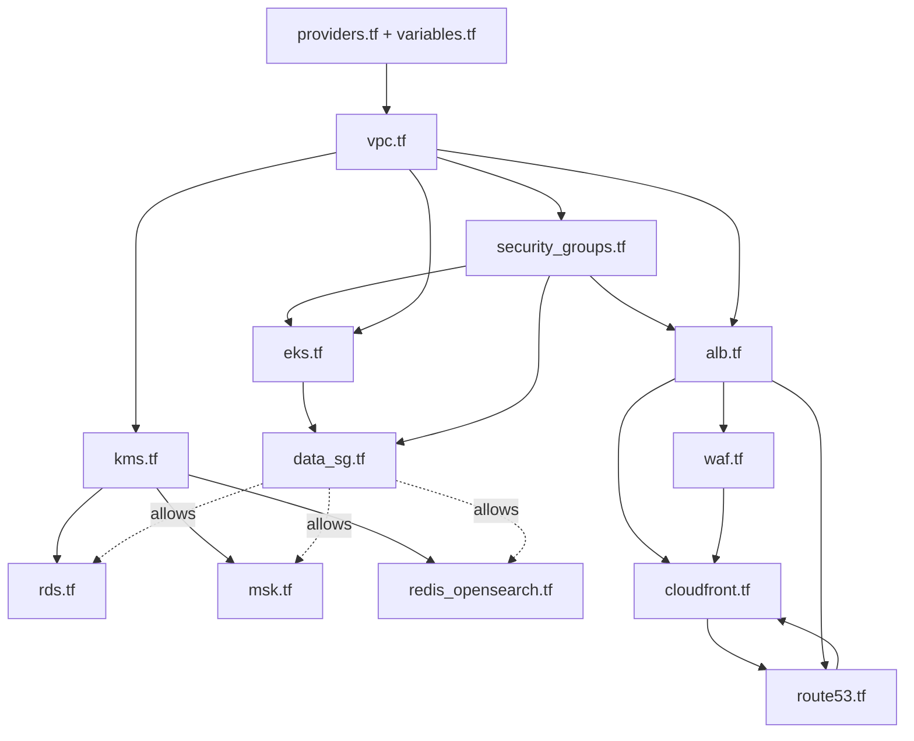

(The CloudFront certificate validation needs DNS records from `route53.tf`, and DNS aliases need the distribution, so Terraform applies them in a sensible order automatically; on the very first run the certificate may need a second `apply`.)

### 6.4 How to run it

```bash
cd infra/terraform
# one-time: create the S3 bucket and DynamoDB table named in providers.tf (or switch to a local backend for a trial)
terraform init
terraform validate
terraform plan  -var 'origin_secret=<random 32+ chars>' -out plan.tfplan
terraform apply plan.tfplan

# first-time order if you prefer small steps
terraform apply -target=module.vpc
terraform apply -target=aws_security_group.data -target=module.eks
terraform apply            # everything else
```

Then read `terraform output` and copy the ALB target-group ARNs into `deploy/values/*.yaml` (`targetGroup.arn`).

### 6.5 Things to know before you apply (honest list)

- **Never planned or applied.** It parses as valid HCL and a dependency cycle and a `for_each` unknown-key issue were fixed, but expect to resolve provider-specific errors.
- **Security groups on EKS.** `aws_security_group.gateway` and `aws_security_group.services` only apply if you use *security groups for pods* (or ECS). With plain EKS node groups, pods share the **node** security group, and `eks.tf` opens port 8080 on it from both ALBs. Decide which model you want and delete the unused one.
- Missing pieces: ALB access-log bucket policy, ACM validation records for the regional certificate, DocumentDB for the Mongo read model, a second region.
- Shield Advanced is off by default (cost).
- Cost drivers: 5 Multi-AZ RDS instances, 3-broker MSK, OpenSearch, 3 NAT gateways, Shield Advanced.

### 6.6 Why Terraform and not Ansible?

They solve different problems and are often used together. For **provisioning cloud infrastructure** Terraform is the better fit:

| Question | Terraform | Ansible |
|---|---|---|
| Model | **Declarative**: describe the desired end state | Mostly **procedural**: ordered tasks (declarative modules, but you manage order and idempotency) |
| State | Keeps **state**, so it knows what exists, can show a **plan**, detect drift and **destroy** cleanly | No built-in state; it re-checks the world each run, so removal and drift are harder |
| Dependency graph | Builds a graph from references and **parallelises** (VPC, subnets, many resources at once) | Runs tasks in the order you write them |
| Cloud coverage | First-class providers for AWS, Azure, GCP, Cloudflare, Kubernetes, Helm, GitHub | Cloud modules exist but are not the primary strength |
| Safety review | `terraform plan` output can be reviewed in a pull request before anything changes | `--check` mode is less complete for many modules |
| Immutable infrastructure | Replace resources, do not patch servers | Great at configuring **inside** servers (packages, files, services) |
| Typical sweet spot | VPCs, load balancers, databases, Kafka, DNS, IAM, Kubernetes clusters | OS hardening, installing software on VMs, orchestrating deployments across hosts |

**What we gain here:** reproducible environments (dev, stage, prod from the same code), a reviewable plan for every change, drift detection, one command to tear a test environment down, dependency ordering for ~70 interlocking AWS resources, and reuse of well-tested community modules (`vpc`, `eks`, `iam`).
**Where Ansible would still help:** configuring VMs if you were not on containers. Here every workload is a container image, so there is nothing to configure inside servers, and Helm covers application deployment.

---

## 7. Kubernetes guide

### 7.1 Big picture

Terraform creates the **cluster** (`eks.tf`). Helm deploys the **applications** into it. The folder `deploy/` contains:

```text
deploy/
├── k8s/
│   ├── namespace.yaml            # the "hms" namespace + default-deny network policies + DNS allowance
│   └── kafka-connect.yaml        # Strimzi KafkaConnect + KafkaConnector (Debezium) for MSK
├── charts/hms-service/           # ONE generic Helm chart reused by every service
│   ├── Chart.yaml                # chart name and version
│   ├── values.yaml               # defaults (replicas, resources, probes settings, autoscaling...)
│   └── templates/
│       ├── deployment.yaml       # the pods
│       ├── service-sa-hpa-pdb.yaml  # Service + ServiceAccount + autoscaler + disruption budget
│       ├── externalsecret.yaml   # pulls secrets from AWS Secrets Manager
│       ├── targetgroupbinding.yaml  # registers pod IPs in the ALB target group
│       └── networkpolicy.yaml    # who may talk to this service
└── values/                       # one small override file per service
    ├── api-gateway.yaml  appointment-service.yaml  billing-service.yaml
    ├── iam-auth-service.yaml  notification-service.yaml
    └── patient-service.yaml  pharmacy-inventory-service.yaml
.github/workflows/deploy-appointment-service.yml   # CI: build, test, push image, helm upgrade
Dockerfile                                         # builds any module into an image
```

**The key idea:** the chart is a *template*; each `values/<service>.yaml` fills it in. One chart, seven deployments. This is why `helm install patient-service ... -f values/patient-service.yaml` and `helm install billing-service ... -f values/billing-service.yaml` produce different services from the same files.

### 7.2 Beginner path: read the files in this order

| Order | File | What to learn | Try this |
|---|---|---|---|
| 1 | `Dockerfile` | How a Maven module becomes a container image (build stage, then a slim JRE image running as non-root user 10001) | `docker build --build-arg MODULE=patient-service -t hms/patient-service .` |
| 2 | `deploy/k8s/namespace.yaml` | A **Namespace** groups resources. The file also installs a **default-deny NetworkPolicy** (nothing talks to anything) and then allows DNS | `kubectl apply -f deploy/k8s/namespace.yaml` then `kubectl get ns hms` |
| 3 | `deploy/charts/hms-service/Chart.yaml` and `values.yaml` | What a Helm chart is and which knobs exist: image, replicas (3), resources, JVM options, autoscaling 3 to 10 at 65% CPU, PDB `minAvailable: 2` | Read the comments next to each key |
| 4 | `deploy/values/patient-service.yaml` | **Overrides only**: image repository, environment variables (DB URL, Kafka bootstrap, JWT issuer), which secrets to pull, the IRSA role, the target group, who may call it | Compare it line by line with `values.yaml` |
| 5 | `templates/deployment.yaml` | The heart: pod spec, probes, security context, graceful shutdown | `helm template patient deploy/charts/hms-service -f deploy/values/patient-service.yaml` and read the rendered YAML |
| 6 | `templates/service-sa-hpa-pdb.yaml` | How pods get a stable name (Service), an identity (ServiceAccount), elasticity (HPA) and protection during node drains (PDB) | `kubectl get svc,hpa,pdb -n hms` |
| 7 | `templates/externalsecret.yaml` | How passwords reach pods without being in Git | `kubectl get externalsecret,secret -n hms` |
| 8 | `templates/targetgroupbinding.yaml` | How the AWS ALB learns pod IPs | `kubectl get targetgroupbinding -n hms` |
| 9 | `templates/networkpolicy.yaml` | The allow rules that open holes in the default-deny policy | `kubectl describe networkpolicy patient-service -n hms` |
| 10 | `deploy/k8s/kafka-connect.yaml` | Running Debezium on Kubernetes using the Strimzi operator | `kubectl get kafkaconnect,kafkaconnector -n hms` |
| 11 | `.github/workflows/deploy-appointment-service.yml` | How CI builds, tests, pushes to ECR and runs `helm upgrade --atomic` | Read top to bottom |

### 7.3 How each file works internally

#### `namespace.yaml`
- Creates namespace `hms` with the label `pod-security.kubernetes.io/enforce: restricted`, so Kubernetes **rejects** pods that run as root, allow privilege escalation or lack a seccomp profile.
- `default-deny` is a NetworkPolicy with an empty `podSelector` (matches all pods) and both policy types, which blocks *all* ingress and egress.
- `allow-dns` re-allows egress to `kube-system` on port 53, otherwise pods cannot resolve names.
- Result: a pod can only do what a later, more specific policy allows.

#### `charts/hms-service/values.yaml`
Defines defaults such as `replicaCount: 3`, `port: 8080`, memory requests/limits, `jvm.opts` (container-aware heap: `MaxRAMPercentage=70`, ZGC), `autoscaling`, `pdb`, `externalSecret.enabled`, `targetGroup.arn`, `network.allowFrom`, `network.allowTo`, `network.egressToDataCidrs`.

#### `templates/deployment.yaml`
- **Rolling update:** `maxSurge: 1`, `maxUnavailable: 0`, so a new pod must be Ready before an old one is removed.
- **Security context:** non-root, read-only root file system (so `/tmp` is an `emptyDir`), all Linux capabilities dropped.
- **Probes:** `startupProbe` (up to 150 s for slow JVM boots) on `/actuator/health/liveness`, then `livenessProbe` (restart if stuck) and `readinessProbe` on `/actuator/health/readiness` (remove from load balancing if not ready).
- **Graceful shutdown:** a `preStop` sleep of 10 s lets the ALB stop sending traffic, then `SERVER_SHUTDOWN=graceful` lets in-flight requests finish within `terminationGracePeriodSeconds: 45`.
- **Config:** `env` from values plus `envFrom` the Secret `<release>-secrets`. A `checksum/env` annotation changes when env values change, which forces a rolling restart.
- **Spread:** `topologySpreadConstraints` places replicas in different AZs.

#### `templates/service-sa-hpa-pdb.yaml`
- **ServiceAccount** carries the `eks.amazonaws.com/role-arn` annotation (IRSA): the pod receives temporary AWS credentials for exactly that IAM role (for example notification-service may only send SES/SNS).
- **Service** maps port 80 to the container port. Other pods use the DNS name `http://patient-service`. This is Kubernetes' built-in service discovery, which is why Eureka is not needed here.
- **HPA** adds pods when average CPU exceeds 65%.
- **PDB** guarantees at least 2 pods stay up during voluntary disruptions such as node drains.

#### `templates/externalsecret.yaml`
An `ExternalSecret` (External Secrets Operator) reads entries from **AWS Secrets Manager** hourly and writes a normal Kubernetes Secret `<release>-secrets`. The Deployment mounts it as environment variables, so database passwords never appear in Git or Helm values.

#### `templates/targetgroupbinding.yaml`
The AWS Load Balancer Controller watches this object and registers each Ready pod **IP** in the Terraform-created ALB target group. This is how the external ALB reaches gateway pods and the internal ALB reaches services without a Kubernetes Ingress.

#### `templates/networkpolicy.yaml`
Opens exactly the needed paths on top of default-deny: ingress from the VPC when a target group exists, ingress from named pods (`allowFrom`), ingress from `monitoring`; egress to named pods (`allowTo`, used so the gateway can reach the services), to data-tier CIDRs (PostgreSQL, Kafka, Redis, Mongo) and to HTTPS 443 (IdP, SES/SNS, AWS APIs).

#### `kafka-connect.yaml`
Installs a **Strimzi `KafkaConnect`** cluster (2 replicas) that builds an image containing the Debezium PostgreSQL connector and the MSK IAM auth jar, plus a **`KafkaConnector`** that tails one database's outbox. The connector settings are identical to `infra/local/connector-template.json` (see section 11.5). One `KafkaConnector` per service database is required (only the appointment one is included as an example).

#### CI workflow
Checks out code, runs `mvn verify`, assumes an AWS role by OIDC (no stored keys), builds and pushes an image tagged with the commit SHA to ECR, then `helm upgrade --install --atomic` so a failed rollout rolls back automatically. Because the EKS API endpoint is private, run it on a runner inside the VPC.

### 7.4 Worked example: follow one service from code to running pod

```bash
# 0. context: kubeconfig points at the EKS cluster (private endpoint: use VPN / bastion / in-VPC runner)
aws eks update-kubeconfig --name hms

# 1. one-time cluster add-ons (AWS Load Balancer Controller, External Secrets, Strimzi, metrics-server)
#    and the namespace with default-deny
kubectl apply -f deploy/k8s/namespace.yaml

# 2. see what Helm WILL create, without touching the cluster
helm template patient-service deploy/charts/hms-service \
     -n hms -f deploy/values/patient-service.yaml --set image.tag=$(git rev-parse --short HEAD) | less

# 3. install for real
helm upgrade --install patient-service deploy/charts/hms-service \
     -n hms -f deploy/values/patient-service.yaml --set image.tag=$(git rev-parse --short HEAD) --atomic --timeout 5m

# 4. watch it come up
kubectl get pods -n hms -l app=patient-service -w
kubectl describe pod -n hms -l app=patient-service | less       # probes, env, events
kubectl logs -n hms -l app=patient-service -f                   # application logs

# 5. test from inside the cluster
kubectl run -n hms curl --rm -it --image=curlimages/curl --restart=Never -- \
     curl -s http://patient-service/actuator/health/readiness
kubectl port-forward -n hms svc/patient-service 8082:80          # then browse http://localhost:8082/actuator/health

# 6. change something and watch the rolling update
helm upgrade patient-service deploy/charts/hms-service -n hms -f deploy/values/patient-service.yaml --set replicaCount=4
kubectl rollout status deploy/patient-service -n hms
helm rollback patient-service -n hms          # go back one revision
```

**Deploy order on a fresh cluster:** `namespace.yaml` -> External Secrets store -> `iam-auth-service` -> `patient-service` -> `billing-service` -> `pharmacy-inventory-service` -> `notification-service` -> `appointment-service` -> `api-gateway` -> Kafka Connect + connectors.

**Common beginner problems**

| Symptom | Likely cause | How to check |
|---|---|---|
| Pod `Pending` | no node has enough CPU/memory, or PDB/topology constraints | `kubectl describe pod` (Events) |
| `CrashLoopBackOff` | bad DB URL/secret, Flyway failed | `kubectl logs --previous` |
| Pod Running but not Ready | readiness probe failing (dependency down) | `kubectl describe pod`, call `/actuator/health` |
| Gateway cannot reach a service | NetworkPolicy missing `allowTo`/`allowFrom` | `kubectl describe networkpolicy`, test with `curl` pod |
| Pod rejected on create | Pod Security `restricted` violation | the error names the offending field |
| Secret missing | ExternalSecret not synced | `kubectl describe externalsecret` |

---

## 8. Run locally, step by step

### 8.1 Prerequisites

| Tool | Version | Check |
|---|---|---|
| JDK | 21 | `java -version` |
| Maven | 3.9+ | `mvn -version` |
| Docker + Compose v2 | recent | `docker compose version` |
| Bash and `curl` | Git Bash or WSL on Windows | needed by `register-connectors.sh` and `demo.sh` |
| Free ports | 5432 (Postgres), 9092 (Kafka), 18083 (Kafka Connect), 6379 (Redis), 27017 (Mongo), 8180 (Keycloak), 8761 (Eureka), 8080 to 8086 (gateway and services) | `lsof -i :PORT` or `netstat -ano` |

> Kafka Connect is published on host port **18083** (container 8083) so it does not collide with `appointment-service` on 8083.

### 8.2 Clone and build

```bash
git clone https://github.com/coder-stat920715/hms-platform.git
cd hms-platform
mvn clean package -DskipTests          # builds all modules; drop -DskipTests once it compiles cleanly
```

### 8.3 Startup order (and why)

The order matters because each step needs the previous one to exist. **Use one terminal per service.**

| Step | What to start | Command | Wait until you see | Why this order |
|---|---|---|---|---|
| **1** | Infrastructure containers | `docker compose -f infra/local/docker-compose.yml up -d` | `docker compose ps` shows all `running`; Keycloak at <http://localhost:8180> | Everything else needs PostgreSQL, Kafka, Redis, MongoDB and the identity provider |
| **2** | **Eureka server** | `mvn -pl eureka-server spring-boot:run` | Dashboard at <http://localhost:8761> loads | The registry must exist **before** any client starts, so clients register on their first heartbeat and the gateway can resolve them |
| **3** | `iam-auth-service` | `mvn -pl iam-auth-service spring-boot:run -Dspring-boot.run.profiles=eureka` | log `Started IamApplication`; appears in Eureka as `IAM-AUTH-SERVICE` | Independent, small; its Flyway run creates its outbox + publication |
| **4** | `patient-service` | `mvn -pl patient-service spring-boot:run -Dspring-boot.run.profiles=eureka` | `PATIENT-SERVICE` in Eureka | Owns patient data; others do not call it but the ABAC demo needs it |
| **5** | `billing-service` | `mvn -pl billing-service spring-boot:run -Dspring-boot.run.profiles=eureka` | `BILLING-SERVICE` in Eureka | **Participants before the orchestrator**: it must be listening for `CreateInvoice` |
| **6** | `pharmacy-inventory-service` | `mvn -pl pharmacy-inventory-service spring-boot:run -Dspring-boot.run.profiles=dev,eureka` | `PHARMACY-INVENTORY-SERVICE` in Eureka; seed drugs loaded (`dev` profile) | Second saga participant |
| **7** | `notification-service` | `mvn -pl notification-service spring-boot:run -Dspring-boot.run.profiles=eureka` | `NOTIFICATION-SERVICE` in Eureka | Pure consumer; log mode prints messages instead of sending |
| **8** | **`appointment-service`** (command + query + saga orchestrator) | `mvn -pl appointment-service spring-boot:run -Dspring-boot.run.profiles=eureka` | `APPOINTMENT-SERVICE` in Eureka | Last of the business services because it **starts the saga** and expects participants to be up (Kafka would buffer anyway) |
| **9** | **Debezium connectors** | `infra/local/register-connectors.sh` | each connector prints `ok`; status `RUNNING` | Needs the `outbox` tables and `dbz_outbox` publications, which exist only after steps 3 to 8 ran Flyway |
| **10** | **`api-gateway`** | `mvn -pl api-gateway spring-boot:run -Dspring-boot.run.profiles=eureka` | `API-GATEWAY` in Eureka | Last: it resolves everything through Eureka and is the public door; starting it earlier just yields 503s |
| **11** | Smoke test | `infra/local/demo.sh` | prints `CONFIRMED` for both bookings | Proves the whole chain |

**Summary of the order:** Docker infra -> **Eureka** -> iam -> patient -> billing -> pharmacy -> notification -> **appointment** -> Debezium connectors -> **API Gateway** -> demo.

### 8.4 Verifying each step

```bash
# Eureka: all instances registered?
curl -s -H 'Accept: application/json' http://localhost:8761/eureka/apps | python3 -c \
  "import sys,json; print([a['name'] for a in json.load(sys.stdin)['applications']['application']])"

# Every service is healthy (these endpoints need no token)
for p in 8081 8082 8083 8084 8085 8086 8080; do echo -n "$p "; curl -s localhost:$p/actuator/health; echo; done

# Debezium connectors running?
curl -s localhost:18083/connectors?expand=status | python3 -m json.tool | grep -E '"name"|"state"'
```

### 8.5 Simpler mode: no Eureka

Skip step 2 and drop `eureka` from every `-Dspring-boot.run.profiles` (pharmacy keeps `dev`). The gateway then uses the default URLs in `api-gateway/src/main/resources/application.yml` (`http://localhost:8082` and so on). This is exactly how Kubernetes behaves (Service DNS names instead of Eureka). Use the same order, minus Eureka.

### 8.6 Stop and reset

```bash
# Ctrl+C each service, then:
docker compose -f infra/local/docker-compose.yml down        # keep data
docker compose -f infra/local/docker-compose.yml down -v     # wipe databases, topics, Keycloak state
```

### 8.7 Dev accounts

Password equals username in the dev realm: `admin1`, `doctor1`, `nurse1`, `reception1`, `billing1`, `pharmacist1`, `patient1`.
Fixed IDs used in the demo: `doctor1 = aaaaaaaa-0000-0000-0000-000000000001`, `patient1 = bbbbbbbb-0000-0000-0000-000000000001`.

---

## 9. Testing guide

Work through these in order. Each level builds confidence for the next. Set up the helper once per terminal:

```bash
GW=http://localhost:8080 ; KC=http://localhost:8180
tok() { curl -sf -d client_id=hms-web -d grant_type=password -d username=$1 -d password=$1 \
        $KC/realms/hms/protocol/openid-connect/token | python3 -c 'import sys,json;print(json.load(sys.stdin)["access_token"])'; }
DOCTOR=aaaaaaaa-0000-0000-0000-000000000001 ; PATIENT=bbbbbbbb-0000-0000-0000-000000000001
```

### Level 1: automated unit tests (no infrastructure)

```bash
mvn -pl patient-service test
```
`HmsPermissionEvaluatorPolicyTest` checks the ABAC policy as a pure function: about 40 named cases (for example "nurse VIP care team: DENY") plus invariants over roughly 4,000 role/sensitivity/action/context combinations (no one deletes; patients never write or read others; only doctors can break-glass and only to read). **Reading its failures tells you exactly which rule broke.** Only this test exists today; see 9.9 for what to add.

### Level 2: infrastructure and service health

| Check | Command | Expected |
|---|---|---|
| Postgres has the six DBs | `docker compose -f infra/local/docker-compose.yml exec postgres psql -U hms -c '\l'` | iam, patient, appointment, billing, pharmacy, notification |
| Flyway ran | `... psql -U hms -d appointment -c '\dt'` | `appointment, slot, appointment_saga, outbox, processed_message, flyway_schema_history` |
| Connectors | `curl -s localhost:18083/connectors/appointment-outbox/status` | `"state":"RUNNING"` |
| Topics exist | `docker compose ... exec kafka /opt/kafka/bin/kafka-topics.sh --bootstrap-server localhost:9092 --list` | `hms.*.events` appear after first traffic |

### Level 3: authentication and authorisation (security tests)

```bash
# 3.1 no token -> 401
curl -s -o /dev/null -w "%{http_code}\n" $GW/api/appointments/search                         # 401

# 3.2 forged/expired token -> 401
curl -s -o /dev/null -w "%{http_code}\n" -H "Authorization: Bearer abc.def.ghi" $GW/api/appointments/search   # 401

# 3.3 wrong role -> 403 (billing clerk cannot publish slots)
curl -s -o /dev/null -w "%{http_code}\n" -X POST $GW/api/appointments/slots -H "Authorization: Bearer $(tok billing1)" \
  -H 'Content-Type: application/json' -d "{\"doctorId\":\"$DOCTOR\",\"start\":\"2030-01-01T09:00:00Z\",\"slotMinutes\":30,\"count\":1}"   # 403

# 3.4 right role -> 201
curl -s -X POST $GW/api/appointments/slots -H "Authorization: Bearer $(tok doctor1)" -H 'Content-Type: application/json' \
  -d "{\"doctorId\":\"$DOCTOR\",\"start\":\"2030-01-01T09:00:00Z\",\"slotMinutes\":30,\"count\":1}"
```

### Level 4: ABAC walk-through (patient records)

```bash
RT=$(tok reception1); DT=$(tok doctor1); NT=$(tok nurse1); PT=$(tok patient1); AT=$(tok admin1)

# register the patient (department cardiology), linked to patient1's login
curl -s -X POST $GW/api/patients -H "Authorization: Bearer $RT" -H 'Content-Type: application/json' -d "{
  \"id\":\"$PATIENT\",\"fullName\":\"Pat Ient\",\"dateOfBirth\":\"1985-04-12\",\"department\":\"cardiology\",
  \"email\":\"pat@example.com\",\"phone\":\"+15550100\",\"channels\":[\"EMAIL\"]}"

code() { curl -s -o /dev/null -w "%{http_code}\n" "$@"; }
echo "NORMAL record:"
code $GW/api/patients/$PATIENT -H "Authorization: Bearer $DT"   # 200 doctor, same department, on shift, trusted network (localhost)
code $GW/api/patients/$PATIENT -H "Authorization: Bearer $NT"   # 200 nurse, same department
code $GW/api/patients/$PATIENT -H "Authorization: Bearer $PT"   # 200 self
code $GW/api/patients/$PATIENT -H "Authorization: Bearer $RT"   # 200 receptionist reads NORMAL
code $GW/api/patients/$PATIENT -H "Authorization: Bearer $AT"   # 200 admin reads NORMAL

# IMPORTANT: add the doctor to the care team BEFORE restricting the record (see note below)
curl -s -X PUT $GW/api/patients/$PATIENT/care-team/$DOCTOR -H "Authorization: Bearer $DT" -o /dev/null -w "%{http_code}\n"   # 204
curl -s -X PUT $GW/api/patients/$PATIENT/sensitivity -H "Authorization: Bearer $DT" -H 'Content-Type: application/json' \
     -d '{"sensitivity":"RESTRICTED"}' -o /dev/null -w "%{http_code}\n"                                                     # 200

echo "RESTRICTED record:"
code $GW/api/patients/$PATIENT -H "Authorization: Bearer $DT"   # 200 on the care team
code $GW/api/patients/$PATIENT -H "Authorization: Bearer $NT"   # 403 same department but NOT on the care team
code $GW/api/patients/$PATIENT -H "Authorization: Bearer $RT"   # 403 receptionist: NORMAL only
code $GW/api/patients/$PATIENT -H "Authorization: Bearer $AT"   # 403 admin: NORMAL only
code $GW/api/patients/$PATIENT -H "Authorization: Bearer $PT"   # 200 patient reads own record
```
Look at the `patient-service` terminal: every decision logs a line like
`access user=... patient=... action=READ decision=DENY flagged=false reason="restricted: not on care team"` (logger `hms.audit`).
Wait up to 30 seconds after changing sensitivity or care team if you bypass the service API (the authorisation cache TTL); changes made through the API evict the cache immediately.

> **Note (known gap):** once a record is `RESTRICTED` or `VIP`, only care-team members can `WRITE` it, including adding more care-team members. Add the care team first, or add a dedicated administrative path. See section 14.

### Level 5: the happy-path booking (follow the data)

```bash
RT=$(tok reception1); DT=$(tok doctor1); PT=$(tok patient1)
START=$(date -u -d 'tomorrow 09:00' +%Y-%m-%dT%H:%M:%SZ)       # macOS: use gdate (brew install coreutils)

# doctor publishes slots
curl -s -X POST $GW/api/appointments/slots -H "Authorization: Bearer $DT" -H 'Content-Type: application/json' \
  -d "{\"doctorId\":\"$DOCTOR\",\"start\":\"$START\",\"slotMinutes\":30,\"count\":4}" | python3 -m json.tool

# book (no prescription)
AID=$(curl -s -X POST $GW/api/appointments -H "Authorization: Bearer $RT" -H 'Content-Type: application/json' \
  -d "{\"patientId\":\"$PATIENT\",\"doctorId\":\"$DOCTOR\",\"slotStart\":\"$START\",\"fee\":120.00}" | python3 -c 'import sys,json;print(json.load(sys.stdin)["id"])')
echo $AID

# immediately: PENDING; after a few seconds: CONFIRMED
curl -s $GW/api/appointments/$AID -H "Authorization: Bearer $PT" | python3 -m json.tool
```

**Now look inside, in the order the data moved** (this is the best way to understand the system):

```bash
DC="docker compose -f infra/local/docker-compose.yml"

# 1. the saga row and appointment (write DB)
$DC exec postgres psql -U hms -d appointment -c "select appointment_id,state,invoice_id from appointment_saga where appointment_id='$AID'"
$DC exec postgres psql -U hms -d appointment -c "select id,status from appointment where id='$AID'"
$DC exec postgres psql -U hms -d appointment -c "select status,appointment_id from slot where appointment_id='$AID'"

# 2. the events on Kafka (key = appointment id, headers eventType + messageId)
$DC exec kafka /opt/kafka/bin/kafka-console-consumer.sh --bootstrap-server localhost:9092 \
   --topic hms.appointment.events --from-beginning --property print.key=true --property print.headers=true --timeout-ms 5000

# 3. the invoice (billing DB) and billing events
$DC exec postgres psql -U hms -d billing -c "select id,appointment_id,amount,status from invoice"
$DC exec kafka /opt/kafka/bin/kafka-console-consumer.sh --bootstrap-server localhost:9092 --topic hms.billing.events \
   --from-beginning --property print.headers=true --timeout-ms 5000

# 4. idempotency ledger (one row per message per consumer)
$DC exec postgres psql -U hms -d appointment -c "select * from processed_message order by processed_at desc limit 5"

# 5. CQRS read model (MongoDB)
$DC exec mongo mongosh hms_read --quiet --eval 'db.appointment_view.find().pretty()'
curl -s $GW/api/appointments/search -H "Authorization: Bearer $PT" | python3 -m json.tool

# 6. the notification (log mode prints it in the notification-service terminal)
#    [EMAIL] to=<patient id> subject="Appointment confirmed" body="Your appointment on ... is confirmed."
```

**With a prescription** (uses the seeded drug `11111111-...`, requires pharmacy started with the `dev` profile):
```bash
S2=$(date -u -d 'tomorrow 09:30' +%Y-%m-%dT%H:%M:%SZ)
curl -s -X POST $GW/api/appointments -H "Authorization: Bearer $RT" -H 'Content-Type: application/json' \
  -d "{\"patientId\":\"$PATIENT\",\"doctorId\":\"$DOCTOR\",\"slotStart\":\"$S2\",\"fee\":80.00,
       \"items\":[{\"drugId\":\"11111111-1111-1111-1111-111111111111\",\"quantity\":2}]}"
$DC exec postgres psql -U hms -d pharmacy -c "select name,on_hand,reserved from drug_stock"     # reserved = 2
```

### Level 6: edge behaviour

| Test | Command | Expected |
|---|---|---|
| **Rate limiting** | `seq 1 400 \| xargs -P 40 -I{} curl -s -o /dev/null -w "%{http_code}\n" $GW/api/appointments/search -H "Authorization: Bearer $PT" \| sort \| uniq -c` | mostly `200` plus some `429` (burst 100, refill 50/s per user) |
| **Circuit breaker** | stop `billing-service`, then `for i in $(seq 1 25); do curl -s $GW/api/invoices/$(uuidgen) -H "Authorization: Bearer $(tok billing1)"; echo; done` | JSON `service_unavailable` fallback from the gateway; after enough failures the circuit opens and answers instantly |
| **Duplicate delivery** | restart a consumer mid-flow (Ctrl+C `billing-service` during a booking, start it again) | no duplicate invoice (`select count(*) from invoice` stays 1 per appointment) |
| **Replay the read model** | stop appointment-service, `db.appointment_view.drop()` in Mongo, reset group `appointment-projector` to earliest, restart | view rebuilt from Kafka |

### Level 7: failure and compensation

Run the scenarios in **section 13** (decline, slot conflict, out of stock, insurer outage, timeout). Each lists the exact request and what you should see in the database and logs.

### 9.8 Expected results cheat-sheet

| After... | Table / topic | Expected |
|---|---|---|
| booking accepted | `appointment.status` | `PENDING` then `CONFIRMED` |
| | `appointment_saga.state` | `SLOT_RESERVED` -> (`INVOICE_CREATED`) -> `CONFIRMED` |
| | `slot.status` | `RESERVED` |
| | `billing.invoice` | one row `ISSUED` |
| any failure | `appointment.status` | `FAILED`, `failure_reason` filled |
| | `slot.status` | back to `FREE` |
| | `invoice.status` | `VOID` if one was created |
| | `drug_stock.reserved` | unchanged or restored |

### 9.9 Tests that should be added next

Saga orchestrator unit tests (every transition and the late-reply cases), outbox atomicity with Testcontainers (a rollback must remove both rows), a Debezium end-to-end test, WireMock tests for the insurer circuit breaker and retry jitter, gateway tests for 401/429 and header stripping, ArchUnit rules (controllers never touch repositories), and contract tests for the event records. Sketches are in `docs/06-tests.md`.

---

## 10. Design patterns used

| # | Pattern | Where in this repo | When it is invoked | One-line workflow |
|---|---|---|---|---|
| 1 | **API Gateway** | `api-gateway` | Every external request | Authenticate, rate limit, route, break the circuit, return fallback |
| 2 | **Rate limiting (token bucket)** | gateway `RequestRateLimiter` + Redis | Every routed request | Take 1 token from the user's bucket; empty bucket returns 429 |
| 3 | **Token-based authentication (OAuth2/OIDC resource server)** | gateway + `ResourceServerSecurityConfig` | Every request, at two layers | Verify signature, expiry, issuer; build authorities from claims |
| 4 | **RBAC** | `@PreAuthorize("hasAnyRole(...)")` in controllers | Every protected endpoint | Role from the JWT must be in the allowed list |
| 5 | **ABAC (policy decision point)** | `HmsPermissionEvaluator` | Every `patient-service` read/write | Evaluate subject + resource + environment attributes; audit |
| 6 | **Service discovery (client-side)** | `eureka-server`, `application-eureka.yml`, gateway `lb://` | Local runs with the `eureka` profile | Register, heartbeat, fetch registry, client-side load balancing |
| 7 | **Database per service** | six PostgreSQL databases | Always | Each service owns its schema; no cross-DB joins |
| 8 | **Saga (orchestration)** | `SagaOrchestrator` | Every booking | Sequence of local transactions driven by replies |
| 9 | **Compensating transaction** | `compensate()`, `VoidInvoice`, `ReleaseInventory`, slot release | A saga step fails or times out | Undo completed steps in reverse order |
| 10 | **Transactional Outbox** | `OutboxEventListener`, `outbox` table | Every state change that must emit a message | Insert message row in the same DB transaction |
| 11 | **Change Data Capture (log-based)** | Debezium + `EventRouter` | Continuously | Read the WAL, publish outbox rows to Kafka |
| 12 | **Idempotent consumer** | `Deduper`, `processed_message` | Every Kafka listener | Insert `consumer:messageId` first; skip if it exists |
| 13 | **CQRS** | `AppointmentProjector` + `/search` | Every appointment event; every search | Write model in Postgres, read model in MongoDB |
| 14 | **Event-carried state transfer** | `PatientProfileChanged` -> notification's `recipient` table | Patient create/update | Copy needed contact data so no synchronous call is needed |
| 15 | **Circuit breaker** | gateway routes, `InsuranceClient`, notification channels | Calls to unreliable dependencies | Closed -> Open on failure rate -> Half-open probes |
| 16 | **Retry with exponential backoff and full jitter** | `RetryJitterConfig`, billing/notification | Transient downstream failures | Wait random(0, 500 ms x 2^(n-1)), max 4 attempts |
| 17 | **Dead-letter queue** | `KafkaErrorConfig` | A message keeps failing | Retry with backoff, then publish to `<topic>.DLT` |
| 18 | **Timeout / watchdog** | `SagaTimeoutSweeper` | Every 30 s | Compensate sagas stuck longer than 2 minutes |
| 19 | **Pessimistic locking (`SKIP LOCKED`)** | `SlotRepository.lockFree`, sweeper, low-stock scan | Booking, sweeping | `SELECT ... FOR UPDATE SKIP LOCKED`: no waiting, no double work |
| 20 | **Optimistic locking** | `@Version` on entities | Concurrent updates | Version mismatch fails the loser |
| 21 | **Atomic conditional update** | `DrugStockRepository.tryReserve` | Stock reservation | `UPDATE ... WHERE on_hand - reserved >= qty` |
| 22 | **Cache-aside** | Caffeine in `JpaPatientResourceLookup` | Each authorisation check | Cache for 30 s, evict on change |
| 23 | **Strategy + fallback chain** | `NotificationChannel`, `NotificationRouter` | Sending a message | Try the patient's preferred channels in order |
| 24 | **Health check API / graceful shutdown** | Actuator probes, `server.shutdown=graceful` | Kubernetes lifecycle | Readiness gates traffic, liveness restarts |
| 25 | **Externalised configuration / secrets** | env vars, External Secrets | Startup | Config from the environment, secrets from Secrets Manager |
| 26 | **Audit logging** | `AuditPublisher`, `BreakGlassUsed` events | Every patient access decision, every break-glass | Structured line / immutable event |

---

## 11. Pattern implementations in detail

### 11.1 API Gateway with rate limiting

**Implementation:** `api-gateway/src/main/resources/application.yml` and `GatewaySecurityConfig.java`.

```yaml
spring.cloud.gateway.default-filters:
  - name: RequestRateLimiter
    args:
      key-resolver: "#{@userKeyResolver}"        # who is being limited
      redis-rate-limiter.replenishRate: 50       # tokens added per second
      redis-rate-limiter.burstCapacity: 100      # bucket size
      redis-rate-limiter.requestedTokens: 1      # cost of one request
```
```java
@Bean KeyResolver userKeyResolver() {            // key = authenticated subject, else client IP
  return exchange -> exchange.getPrincipal().map(p -> p.getName())
      .switchIfEmpty(Mono.fromSupplier(() -> /* remote address or "anonymous" */));
}
```

**How the token bucket works.** Each user has a bucket in Redis holding up to **100 tokens**, refilled at **50 per second**. A request removes one token; if the bucket is empty the gateway answers **429 Too Many Requests**. So a user can burst 100 requests instantly, then sustain 50 per second. Redis runs a small Lua script so "check and take a token" is **atomic** across all gateway replicas, which is why the limit holds no matter which replica serves the call. The response carries `X-RateLimit-Remaining`, `X-RateLimit-Replenish-Rate` and `X-RateLimit-Burst-Capacity` headers.

**Behaviour to know:** the filter is a *default filter*, so it applies to every route; it runs before routing but after authentication so the key is the user, not the IP. If Redis is unreachable the limiter **fails open**. The WAF's 2,000-requests-per-5-minutes-per-IP rule is the second, coarser layer at the edge.
**Per-route tuning:** add a `RequestRateLimiter` filter with different `replenishRate` on one route to override the default.
**Test:** section 9, Level 6.

### 11.2 JWT with OAuth2 / OIDC authentication

**Implementation:** `GatewaySecurityConfig` (reactive), `hms-common/.../ResourceServerSecurityConfig` (servlet), `spring.security.oauth2.resourceserver.jwt.issuer-uri` in every `application.yml`, `infra/keycloak/realm-hms.json`.

**Flow**
1. The user authenticates at the IdP (Keycloak or Cognito) using OIDC. Web apps should use **authorization code + PKCE**; the dev realm also enables the password grant for `curl` convenience, **dev only**.
2. The IdP returns a signed JWT (RS256) lasting 5 minutes with claims `sub`, `iss`, `exp`, `realm_access.roles`, and our custom `department`, `shift_start`, `shift_end` (added by protocol mappers on the `hms-web` client).
3. The client sends `Authorization: Bearer <jwt>`.
4. At startup (lazily, on first request) Spring reads `<issuer-uri>/.well-known/openid-configuration`, finds the `jwks_uri` and downloads the public keys. Each request's signature is verified with the key matching the token's `kid`; `exp`, `nbf` and `iss` are validated. Keys are cached and refreshed on an unknown `kid`.
5. The gateway **does not strip** the token. Each service validates it again (zero trust) so a compromised or misconfigured network path does not bypass security.
6. `ResourceServerSecurityConfig` converts roles to authorities: `doctor` becomes `ROLE_DOCTOR`; Cognito groups (`cognito:groups`) are supported too.

**Stateless:** no session, CSRF disabled (bearer tokens are not sent automatically by browsers). **Public paths:** only `/actuator/health/**` and `/actuator/prometheus`.
**Known gaps:** the audience (`aud`) claim is not validated yet; there is no token revocation list (short lifetime is the mitigation); no mTLS between services.

### 11.3 RBAC and ABAC

#### RBAC: who you are

Method security is enabled by `@EnableMethodSecurity`. Controllers declare allowed roles:

```java
@PreAuthorize("hasAnyRole('RECEPTIONIST','DOCTOR','PATIENT')")
@PostMapping public ResponseEntity<AppointmentDto> book(...)
```

| Role | Can do (summary) |
|---|---|
| `ROLE_ADMIN` | Read `NORMAL` patient records; publish slots; read invoices, appointments, stock; create drugs |
| `ROLE_DOCTOR` | Publish slots; book; read/write patients through ABAC; read stock; declare break-glass |
| `ROLE_NURSE` | Read appointments and stock; read/write patients through ABAC |
| `ROLE_PATIENT` | Book for self; see own appointments; read own patient record |
| `ROLE_RECEPTIONIST` | Register patients; book; read `NORMAL` patient demographics |
| `ROLE_BILLING_CLERK` | Read invoices; mark paid; read `NORMAL` patient demographics |
| `ROLE_PHARMACIST` | (addition) Manage stock and restock |

#### ABAC: who you are **plus** the situation

RBAC alone cannot say "a cardiologist may read this patient only while on shift, from the hospital network, if the patient is not VIP unless they are on the care team". That is ABAC. It lives in `patient-service/.../security/HmsPermissionEvaluator.java` and is invoked by

```java
@PreAuthorize("hasPermission(#id, 'Patient', 'READ')")
@GetMapping("/{id}") public PatientDto get(@PathVariable UUID id)
```

**Attributes**

| Kind | Attribute | Source |
|---|---|---|
| Subject | user id (`sub`), department, shift start/end, roles | JWT claims |
| Resource | patient id, sensitivity, department, care team | `patient` tables via `PatientResourceLookup` (cached 30 s) |
| Action | READ, WRITE, DELETE | the permission string |
| Environment | caller IP in a trusted CIDR, break-glass flag | `request.getRemoteAddr()` (via `X-Forwarded-For` through trusted proxies), request header |

**Policy (the `decide()` method; a pure function)**

| Role | Rule |
|---|---|
| Any | Unknown role or unparsable claims: **DENY** (fail closed). Missing patient: **DENY** (not 404, to hide existence). `DELETE` is never allowed for clinical roles |
| `ADMIN` | READ on `NORMAL` only |
| `PATIENT` | READ own record only |
| `RECEPTIONIST`, `BILLING_CLERK` | READ on `NORMAL` only |
| `DOCTOR`, `NURSE` | Must be **on shift** (handles overnight shifts) **and** on a **trusted network**; then `NORMAL`: same department **or** care team; `RESTRICTED`: care team only; `VIP`: care-team **doctor** only |
| `DOCTOR` break-glass | READ only, bypasses shift/network/relationship, **flagged** for review. **Disabled by default** (`hms.security.break-glass-enabled=false`) |

**Wiring:** `MethodSecurityConfig` registers a lazy `PermissionEvaluator` delegate (avoids early initialisation of cached beans). `AuditPublisher` logs every decision to the `hms.audit` logger. **Test:** `HmsPermissionEvaluatorPolicyTest`.

### 11.4 Eureka server (service discovery)

**Implementation:** module `eureka-server` (`@EnableEurekaServer`, port 8761); client dependency in `hms-common` and `api-gateway`; profile files `hms-common/src/main/resources/application-eureka.yml` and `api-gateway/src/main/resources/application-eureka.yml`.

**How it works**
1. Eureka server starts as a standalone registry (`register-with-eureka: false`, `fetch-registry: false`).
2. A service started with profile `eureka` registers `{spring.application.name, ip, port}`, e.g. `PATIENT-SERVICE`.
3. Each instance sends a **heartbeat every 5 s**; the registry evicts instances silent for **15 s** (checked every 5 s locally).
4. Clients **fetch the registry every 5 s** and cache it locally.
5. The gateway profile defines routes as `uri: lb://patient-service`. For each request the Spring Cloud LoadBalancer picks one instance of that name (round-robin) from its cached registry: this is **client-side load balancing**, no central proxy.
6. Without the profile (the default) `eureka.client.enabled=false` and the gateway uses plain URLs.

**Why it is optional:** on Kubernetes the cluster already provides discovery and load balancing (Service DNS + kube-proxy), so running Eureka would duplicate it. Use Eureka for local runs or VM deployments; use Kubernetes Services in EKS.
**Limits:** single node here; self-preservation off for dev; no security on the dashboard.

### 11.5 Saga with Transactional Outbox and Debezium CDC

#### Why orchestration

Booking needs a defined order (slot, then invoice, then stock) and clear compensation, so one service (`appointment-service`) **orchestrates** and knows the whole flow. Choreography (each service reacting to the previous one's event) would scatter that logic and make "what happens if stock is missing?" hard to read. The cost is a coordinating service, accepted here.

#### The moving parts

| Part | Class / file | Job |
|---|---|---|
| Domain event | `hms-common/.../outbox/DomainEvent` | In-memory request to emit a message |
| Outbox write | `OutboxEventListener` (`@TransactionalEventListener(BEFORE_COMMIT)`) | Saves an `OutboxEvent` row in the **same transaction** |
| Outbox table | `outbox(id, aggregatetype, aggregateid, type, payload, created_at)` | Durable, atomic queue |
| Relay | Debezium PostgreSQL connector + `EventRouter` | Reads the WAL, publishes to Kafka |
| Saga state | `appointment_saga` | Where each booking is up to |
| Orchestrator | `SagaOrchestrator` | Decides next step or compensation |
| Dedupe | `Deduper` | Makes redelivery harmless |

#### Step 1: write state and message atomically

```java
@Transactional
public Appointment book(BookCommand c) {
  var a = appointments.save(new Appointment(...));                 // state
  events.publishEvent(new DomainEvent("appointment", a.getId().toString(),
        "AppointmentRequested", new AppointmentRequested(...)));    // message -> outbox, same transaction
  saga.start(a, c.items());      // locks slot, saves saga row, publishes the CreateInvoice command to the outbox
  return a;
}
```
If anything throws, **everything** rolls back, including the outbox rows. There is no state without its message and no message without its state.

#### Step 2: Debezium turns outbox rows into Kafka records

An outbox row such as
```json
{ "id":"7c1b...", "aggregatetype":"billing-commands", "aggregateid":"3f2c...(appointmentId)",
  "type":"CreateInvoice", "payload":"{\"appointmentId\":\"3f2c...\",\"patientId\":\"bbbb...\",\"fee\":120.00}" }
```
becomes a Kafka record on `hms.billing-commands.events` with **key** `3f2c...` (so all messages for one booking stay in order in one partition), **headers** `eventType=CreateInvoice`, `messageId=7c1b...`, and the payload expanded as the value.

Key connector settings (`infra/local/connector-template.json`):

| Setting | Value | Meaning |
|---|---|---|
| `plugin.name` | `pgoutput` | Postgres logical decoding plugin |
| `table.include.list` | `public.outbox` | Only the outbox is captured |
| `publication.name` | `dbz_outbox` | Created by Flyway (`CREATE PUBLICATION`) |
| `slot.name` | `<db>_outbox_slot` | Replication slot = Debezium's bookmark in the WAL |
| `transforms` | `EventRouter` | Converts rows to business events |
| `route.by.field` / `route.topic.replacement` | `aggregatetype` / `hms.${routedByValue}.events` | Topic naming |
| `table.field.event.key` | `aggregateid` | Kafka key |
| `table.fields.additional.placement` | `type:header:eventType,id:header:messageId` | Headers consumers read |
| `table.expand.json.payload` | `true` | Payload as JSON, not an escaped string |

#### Step 3: participants reply the same way

`billing-service` consumes the command, performs its local transaction (invoice row **and** `InvoiceCreated`/`InvoiceFailed` outbox row), and Debezium publishes the reply keyed by the same appointment id.

#### Step 4: the orchestrator advances or compensates

```java
case "InvoiceCreated" -> {
  if (saga.getState() == FAILED) { command(BILLING_COMMANDS, id, "VoidInvoice", ...); return; } // late reply: no orphan invoice
  if (saga.getState() != SLOT_RESERVED) return;                                                  // duplicate / out of order
  saga.setInvoiceId(ev.invoiceId());
  if (saga.isNeedsPharmacy()) { saga.setState(INVOICE_CREATED); command(PHARMACY_COMMANDS, id, "AllocateInventory", ...); }
  else confirm(saga);
}
```
`compensate()` runs in **reverse order**: void the invoice if one exists, release the slot, mark the saga and the appointment `FAILED`, publish `AppointmentFailed` (which notifies the patient).

| Failing step | Compensations performed |
|---|---|
| Slot not free | none needed (nothing reserved) |
| Invoice fails | release slot |
| Stock allocation fails | void invoice, release slot |
| No reply in 2 minutes | (if past invoice) `ReleaseInventory`, void invoice, release slot |

#### Why it is safe

| Risk | Defence |
|---|---|
| Crash between DB commit and Kafka publish | Outbox row is in the same commit; Debezium publishes later |
| Duplicate delivery (at-least-once) | `processed_message` insert-or-skip inside the consumer transaction; commands and replies are also idempotent by design (`UNIQUE(appointment_id)`, allocation lookup) |
| Out-of-order or late messages | State checks in the orchestrator (see code above) |
| Lost reply | Timeout sweeper |
| Poison message | Retry with backoff, then `<topic>.DLT` |

### 11.6 CQRS

**Command (write) side:** `AppointmentService.book`, `SagaOrchestrator`, JPA entities in PostgreSQL. Optimised for ACID correctness and locking.
**Query (read) side:** `AppointmentProjector` consumes `hms.appointment.events` and upserts an `AppointmentView` document in MongoDB; `AppointmentSearchController` reads **only** that collection.

```java
@KafkaListener(topics = Topics.APPOINTMENT, groupId = "appointment-projector")
public void project(ConsumerRecord<String,String> r) {
  switch (EventHeaders.eventType(r)) {
    case "AppointmentRequested" -> views.save(new AppointmentView(id, patientId, doctorId, slot, "PENDING"));
    case "AppointmentConfirmed" -> views.findById(id).ifPresent(v -> { v.setStatus("CONFIRMED"); views.save(v); });
    case "AppointmentFailed"    -> views.findById(id).ifPresent(v -> { v.setStatus("FAILED"); v.setFailureReason(...); views.save(v); });
  }
}
```

**Properties:** the read model is **eventually consistent** (projection lag target under 2 s); upserts are idempotent so replays are safe; the view can be **rebuilt** by resetting the consumer group to the beginning; read scale is independent of write scale; search shapes (by patient, doctor, status) are indexed in Mongo and need no joins. The same service hosts both sides, split by package and data store, and can be separated later.
**Honest note:** there is **no L2 Redis cache** on the query side and no Caffeine there; Mongo reads are direct. Caffeine is used only inside `patient-service` for authorisation lookups.

### 11.7 Circuit breaker

Three places use Resilience4j:

| Where | Protects | Configuration |
|---|---|---|
| **Gateway** (`CircuitBreaker` filter on each route) | Clients and the gateway from a failing service | `application.yml` -> `resilience4j.circuitbreaker.configs.default`: count-based window 20, minimum 10 calls, failure threshold 50%, open for 20 s, 5 probe calls; `fallbackUri: forward:/fallback/<service>` returns a JSON 503 |
| **`InsuranceClient`** (`@CircuitBreaker(name="insurance")`) | Billing from the external insurer | count window 20, 50% failures, slow-call threshold 2 s at 80%, open 20 s, auto half-open |
| **Notification channels** (`ses`, `sns`) | The service from AWS outages | window 20, 50%, open 30 s |

**States**
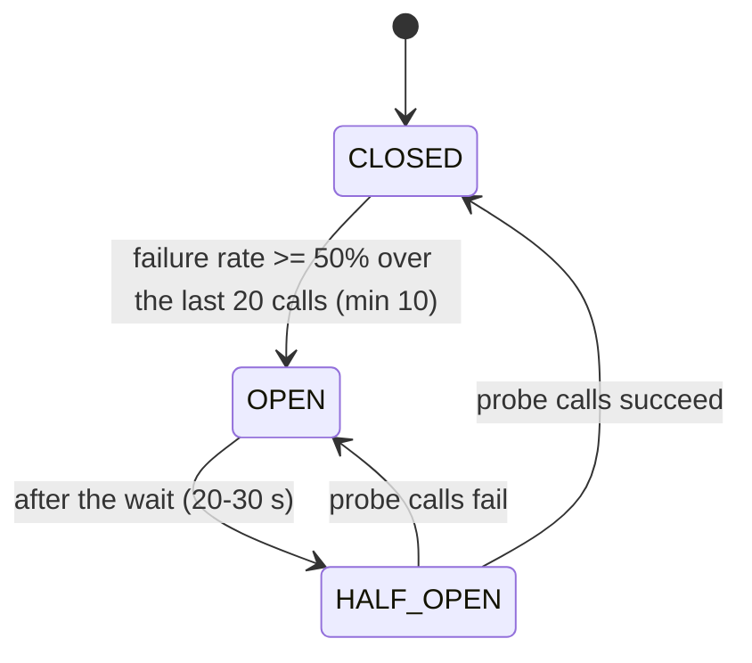
`CLOSED` passes calls and counts failures; `OPEN` rejects immediately (`CallNotPermittedException`, no waiting); `HALF_OPEN` allows 5 trial calls.

**With retry.** In `InsuranceClient`, `@Retry` is the **outer** layer and `@CircuitBreaker` the inner. The breaker's fallback throws `DownstreamUnavailableException`, which the retry policy retries (**max 4 attempts**, waits `random(0, 500 ms x 2^(n-1))`: **full jitter**, installed by `RetryJitterConfig`). If all attempts fail, `InvoiceService` publishes `InvoiceFailed` and the saga compensates. Jitter prevents all callers retrying at the same instant when the insurer recovers (thundering herd).

**Not implemented (despite earlier designs):** bulkhead and thread-pool isolation are described in `docs/` but not wired into the code.

### 11.8 Idempotent consumers and dead letters

```java
@KafkaListener(topics = Topics.BILLING_COMMANDS, groupId = "billing")
@Transactional
public void on(ConsumerRecord<String,String> r) {
  if (!deduper.firstTime(r, "billing")) return;        // insert "billing:<messageId>" ON CONFLICT DO NOTHING
  ...                                                  // business work in the same transaction
}
```
The insert uses `ON CONFLICT DO NOTHING` and returns a row count, so a duplicate **does not throw** (an exception would abort the PostgreSQL transaction). If business work fails the whole transaction, including the ledger row, rolls back, so the retry processes it properly.
`KafkaErrorConfig`: exponential backoff 500 ms x 2 up to 10 s between attempts, about 30 s total, then `DeadLetterPublishingRecoverer` publishes to `<topic>.DLT`. JSON/argument errors are **not retried** (they go straight to the DLT). On Amazon MSK create the DLT topics first (auto-create is off).

---

## 12. Transactional Outbox vs Debezium CDC (FAQ)

### Q1. What is the functional difference?

They are **not competitors**; they solve different halves of one problem.

| | **Transactional Outbox** | **Debezium CDC (change data capture)** |
|---|---|---|
| What it is | A **pattern**: write the message to an `outbox` table in the same transaction as the state change | A **tool/technique**: read the database's transaction log and turn committed changes into events |
| Solves | The **dual-write problem** (DB and broker cannot be updated atomically) | **Moving data out of a database** reliably, in order, without polling and without touching application code |
| Where it runs | Inside your service code | Outside the service (Kafka Connect), reading the WAL/binlog |
| Produces | Whatever *business event* you decide to write (`InvoiceCreated`) | Whatever the log contains: row-level changes (insert/update/delete of any table) |
| Needs the other? | Needs **some relay** to move rows to the broker: a polling publisher **or** CDC | Does **not** need an outbox, but without one you publish raw table changes |

Short version: **the outbox makes the event durable; CDC is one way to deliver it.**

### Q2. How do they work together with Saga?

A saga is a chain of local transactions connected by messages; if a message is lost or invented the saga is wrong.

```text
 service tx:  [ business change  +  outbox row ]  --commit-->  WAL  --Debezium-->  Kafka  --> next saga step
                 (atomic, outbox pattern)                       (relay, CDC)
```
Outbox guarantees *"no change without its message, no message without its change"*. Debezium guarantees *"every committed outbox row reaches Kafka, in order, at least once"*. The saga's idempotent consumers absorb the at-least-once duplicates. This is what the repo does.

### Q3. Can they work separately?

**Yes, both ways.**

- **Outbox without Debezium:** a **polling publisher** (a scheduled job `SELECT ... FROM outbox WHERE not published ORDER BY id`, send, mark sent) or a library such as Spring Modulith's event publication registry. Works on any database.
- **Debezium without an outbox:** capture the **domain tables** directly (`appointment`, `invoice`) and publish their row changes. No extra table or code, but consumers see **table-shaped data**, not business events.

### Q4. When choose **only Transactional Outbox** (polling) with a Saga?

Choose it when you cannot or do not want to run Kafka Connect/Debezium:
- Moderate volume (hundreds of events per second at most) and a latency of 100 ms to a few seconds is fine.
- The database does not expose its log to you (some managed or legacy DBs), or the team has no Connect operations skills.
- You want the smallest possible infrastructure (a service, a database, a broker).

*Example:* a small clinic system with a booking saga of 50 bookings per minute on one PostgreSQL instance. A scheduled publisher every 200 ms is simple and enough.
*Trade-offs:* polling adds read load and latency; multiple publisher instances need coordination (`SKIP LOCKED`); ordering must be handled carefully; scales worse than log tailing.

### Q5. When choose **only Debezium CDC** (no explicit outbox) with a Saga?

Rarely, and only for a **choreographed** saga where **the state change itself is the event**: for example a status column changing to `PAYMENT_FAILED` is exactly what the next service needs to hear.
- Good when you want zero application changes (legacy system, strangler migration) or you must stream existing tables.
- Weak for **orchestrated** sagas that send **commands** (`CreateInvoice`): a command is not a row change, so you end up creating a "command table" which is an outbox again.
- Risks: you leak your **internal schema** as a public contract; every column change becomes a breaking change; one business action touching several tables produces several uncoordinated events; no place for intent, event type or headers.

*Example:* mirroring a legacy `patients` table into a search index: CDC on the table is perfect. For "book an appointment", write an outbox event.

### Q6. When use **both together** (this project)?

Whenever you need **business-meaningful, reliable events** at **scale** from a database that supports log decoding (PostgreSQL, MySQL, SQL Server, Oracle, MongoDB):
- Orchestrated or choreographed sagas on Kafka.
- Low latency (sub-second) without polling load.
- Strict per-aggregate ordering (key = aggregate id).
- Many services, each with its own database and connector.

*Example:* the booking saga here. The outbox encodes intent (`CreateInvoice`, `AppointmentConfirmed`); Debezium delivers it reliably and cheaply.

### Q7. Can they work **without** a Saga?

**Yes.** Neither is tied to sagas.

| Use case | Pattern | Example |
|---|---|---|
| Reliable integration events with no compensation needed | Outbox (+ any relay) | `PatientProfileChanged` -> notification keeps a contact copy. No saga, still must not be lost |
| Cache invalidation / search index refresh | CDC on tables | Evict a cached patient when its row changes |
| Read-model projection (CQRS) | Outbox events or CDC | The Mongo `appointment_view` |
| Data lake / analytics / audit trail | CDC | Stream all changes of the billing DB to S3 |
| Zero-downtime migration (strangler fig) | CDC | Replicate legacy tables to the new service |
| Notifications and webhooks | Outbox | "Invoice paid" email |

### Q8. Does a Saga *need* an outbox?

A saga needs **reliable, atomic messaging plus idempotent handling**. The outbox is the standard way to get the first. Alternatives are worse or narrower: distributed transactions (2PC/XA, rarely supported with Kafka and hurting availability), event sourcing (changes the whole persistence model), or accepting dual writes with retries and reconciliation (acceptable only for low-stakes flows). For money, stock and patient data, use the outbox.

### Q9. Decision guide

| Your situation | Choose |
|---|---|
| Saga on Kafka, PostgreSQL/MySQL, many events, low latency | **Outbox + Debezium** |
| Saga, small scale, no appetite for Connect | **Outbox + polling publisher** |
| Need to stream existing tables as they are (search, analytics, cache, migration) | **Debezium only** |
| Reliable one-off integration event, no saga | **Outbox** (relay of your choice) |
| Legacy system you cannot change, choreographed reactions to status changes | **Debezium on tables**, accept the schema coupling |
| Database offers no log access | **Outbox + polling** |

**What goes wrong without an outbox (the two failure windows)**
1. DB commit succeeds, then the app crashes before publishing -> a state change with **no event**; the saga stalls forever.
2. Message published, then the DB transaction rolls back -> an event for something that **never happened**; downstream services act on a lie.
The outbox closes both windows.

---

## 13. Failure scenarios and compensation flows

> In a ticket-booking reference, "a passenger name starting with `FAIL` makes the simulated payment gateway decline, which triggers SAGA compensation." The HMS equivalent: **a fee of 10,000.00 or more makes the simulated insurer decline**, which triggers SAGA compensation. (This simulation is active only when no `INSURANCE_URL` is configured.)

Set `RT=$(tok reception1)`, a published free slot `$START` and `$PATIENT`, `$DOCTOR` as in section 9.

### F1. Insurance declines the claim (the "FAIL" case)

```bash
curl -s -X POST $GW/api/appointments -H "Authorization: Bearer $RT" -H 'Content-Type: application/json' \
  -d "{\"patientId\":\"$PATIENT\",\"doctorId\":\"$DOCTOR\",\"slotStart\":\"$START\",\"fee\":15000.00}"
```
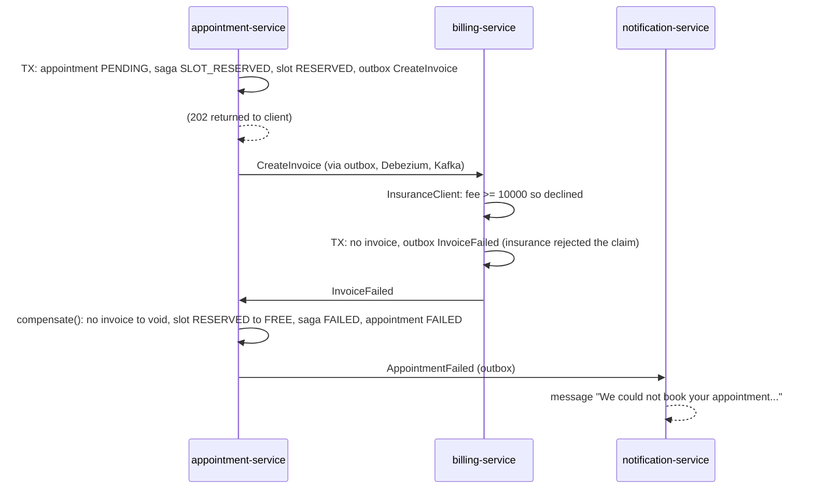
**Verify:** `appointment.status = FAILED`, `failure_reason = insurance rejected the claim`; `slot.status = FREE`; no invoice row; `appointment_view.status = FAILED`; the notification log shows `Appointment could not be booked`. The slot can be booked again immediately.

### F2. The slot is already taken

Book the same `slotStart` twice. The second request returns **202**, but inside the same transaction `lockFree` finds no free slot, so the saga goes straight to `FAILED` with `failure_reason = slot unavailable`. **No command is sent**, nothing needs compensating. (Concurrent attempts are safe: `SKIP LOCKED` plus the unique index.)

### F3. Out of stock (second saga step fails: invoice must be voided)

```bash
curl -s -X POST $GW/api/appointments -H "Authorization: Bearer $RT" -H 'Content-Type: application/json' \
  -d "{\"patientId\":\"$PATIENT\",\"doctorId\":\"$DOCTOR\",\"slotStart\":\"$START\",\"fee\":50.00,
       \"items\":[{\"drugId\":\"11111111-1111-1111-1111-111111111111\",\"quantity\":100000}]}"
```
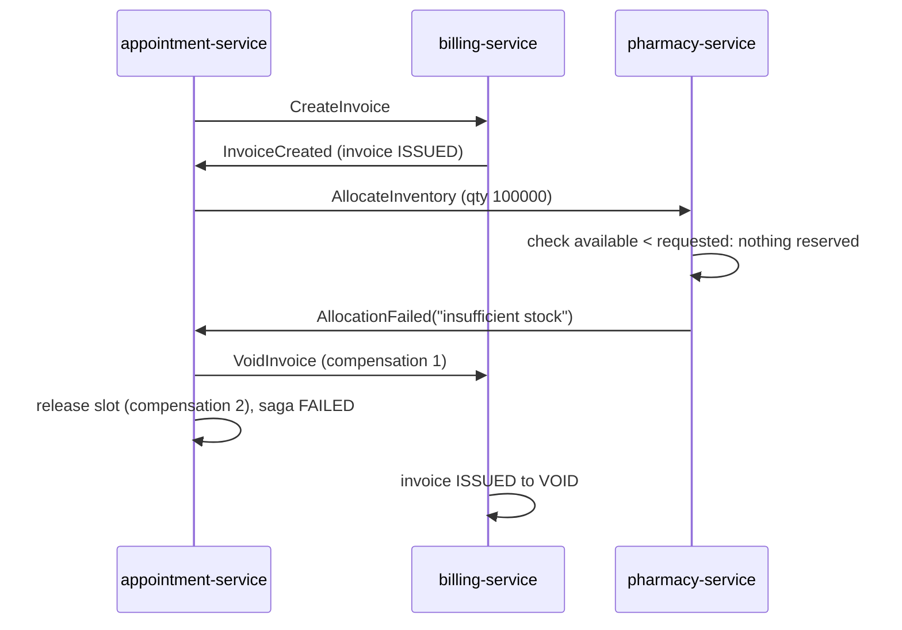
**Verify:** `invoice.status = VOID`; `slot.status = FREE`; `drug_stock.reserved` unchanged; appointment `FAILED` with `inventory unavailable`.

### F4. The insurer is down (retry, then circuit breaker, then compensation)

Start billing with a dead insurer: `INSURANCE_URL=http://localhost:9 mvn -pl billing-service spring-boot:run -Dspring-boot.run.profiles=eureka`. Book normally. Billing retries up to 4 times with jittered waits, then publishes `InvoiceFailed("insurance verification unavailable")`; after about 10 failures the breaker opens and later bookings fail instantly. The saga compensates exactly as in F1.

### F5. A participant is down (timeout compensation)

Stop `billing-service`, book, and watch `appointment_saga.state` stay `SLOT_RESERVED`. After the timeout (`hms.saga.timeout`, default 2 minutes; run appointment-service with `HMS_SAGA_TIMEOUT=PT20S` to test quickly) the sweeper marks it `FAILED` and frees the slot. Start billing again: the queued `CreateInvoice` arrives late, creates an invoice, and the **late-reply rule** sends `VoidInvoice`, so no orphan invoice remains.

### F6. Duplicate delivery

Restart a consumer mid-flow or replay a topic offset. `processed_message` already holds `consumer:messageId`, so the handler returns without effects. Verify: one invoice per appointment, one reservation per drug.

### F7. Kafka or Debezium is down

`docker compose stop connect`, book, and see `202` returned and rows in `appointment.outbox`; nothing moves. `docker compose start connect`: the connector resumes from its replication-slot position and the saga completes (latency, not loss). If it stays down longer than the saga timeout, the sweeper compensates.

### F8. Poison message

```bash
docker compose -f infra/local/docker-compose.yml exec -T kafka /opt/kafka/bin/kafka-console-producer.sh \
  --bootstrap-server localhost:9092 --topic hms.billing-commands.events \
  --property parse.key=true --property key.separator=: <<< 'k1:{not-json'
# then consume the dead letter
docker compose -f infra/local/docker-compose.yml exec kafka /opt/kafka/bin/kafka-console-consumer.sh \
  --bootstrap-server localhost:9092 --topic hms.billing-commands.events.DLT --from-beginning --timeout-ms 5000
```
The record has no `eventType` header, so the listener throws `IllegalArgumentException` (not retryable) and it lands in the DLT without blocking the partition.

### F9. Service crashes mid-transaction

Because state and outbox row share a transaction, a crash leaves either both or neither. After restart, Kafka redelivers the uncommitted message and the dedupe ledger (also in that transaction) lets it be processed exactly once in effect.

### Failure summary

| Failure | Detected by | Result |
|---|---|---|
| Declined claim | `InvoiceFailed` | release slot, FAILED, notify |
| Slot conflict | `lockFree` empty | immediate FAILED |
| Out of stock | `AllocationFailed` | void invoice, release slot, FAILED |
| Insurer outage | retry + circuit breaker | `InvoiceFailed`, compensation |
| No reply | sweeper (2 min) | compensate, late replies undone |
| Duplicate | `processed_message` | ignored |
| Broker/relay down | outbox buffers | delayed, not lost |
| Poison message | error handler | DLT after backoff |

---

## 14. Known gaps, roadmap and troubleshooting

### 14.1 Known gaps (be aware before production)

1. **Never compiled or run** (top of this file). Hibernate `ddl-auto: validate` may surface column-type mismatches.
2. **Break-glass is disabled by default.** The signal is a spoofable request header. Replace it with a short-lived signed claim issued after a justification, then enable `hms.security.break-glass-enabled`.
3. **Care-team deadlock on restricted records:** once a record is `RESTRICTED`/`VIP`, only care-team members can write it, including adding care-team members. Add the care team first or introduce an administrative path.
4. **No mTLS** between services; use a service mesh or ACM Private CA. **No `aud` validation** and no token revocation.
5. **No `@RetryableTopic`**: retries are blocking with `DefaultErrorHandler` then DLT. **No L2 Redis cache.** **No bulkhead.** **No real payment service** (billing models insurance eligibility and invoices only).
6. **Terraform** never planned/applied; Route 53 health-check/origin-header problem; missing ALB log bucket policy, regional ACM validation, DocumentDB (the code uses MongoDB but Terraform still provisions OpenSearch); security-group model decision for EKS (section 6.5). The `docs/` folder contains **earlier iterations** of some Terraform/Helm snippets; the files under `infra/` and `deploy/` are authoritative.
7. Only the ABAC policy is covered by automated tests.
8. Dev-only conveniences: password grant, `sslRequired: none`, default encryption key, plaintext Kafka/Mongo.
9. Notification templates are English-only; no user administration API; no OpenAPI/Swagger UI.

### 14.2 Roadmap (suggested order)

Make it compile and pass tests -> saga and outbox integration tests (Testcontainers) -> signed break-glass claim -> `aud` validation -> service mesh mTLS -> terraform plan in a sandbox -> OpenAPI docs -> payments service -> Kafka Streams or Flink analytics via CDC.

### 14.3 Troubleshooting

| Symptom | Likely cause | Fix |
|---|---|---|
| Service fails at startup with `Schema-validation: wrong column type` | Entity/migration mismatch | Fix the Flyway migration or temporarily `spring.jpa.hibernate.ddl-auto=none` |
| `publication "dbz_outbox" does not exist` when registering a connector | Service has not run Flyway yet | Start that service first (section 8.3, steps 3 to 8), then register connectors |
| Connector state `FAILED` | WAL level or privileges | `show wal_level;` must be `logical`; docker-compose sets it; check `curl localhost:18083/connectors/<name>/status` |
| Events never arrive | Connector not registered, or routing topic name differs | `kafka-topics.sh --list`; check `aggregatetype` values |
| `401` with a valid token | Token issuer differs from `issuer-uri` (for example you fetched the token via a different hostname) | Use `http://localhost:8180/realms/hms` for both |
| `403` for a doctor on a patient | Not on shift, not in a trusted CIDR, not same dept/care team, wrong sensitivity | Read the `hms.audit` log line: it states the reason. Trusted CIDRs default to `10.0.0.0/8,127.0.0.1/32,::1/128` |
| Gateway returns `503 service_unavailable` | Downstream is down or the circuit is open | Check the service health and Eureka registration |
| `lb://...` route returns 503 "Unable to find instance" | Service not registered, or started without the `eureka` profile | Check the Eureka dashboard |
| Appointment stays `PENDING` | Connector not running, participant down, or consumer error | Check connector status, consumer logs, `<topic>.DLT` |
| `429` unexpectedly | Rate limit burst | Wait for the bucket to refill, or raise `burstCapacity` |
| Mongo errors in `/search` | MongoDB container not running | `docker compose ps` |
| `date: illegal option -d` (macOS) | BSD `date` | `brew install coreutils` and use `gdate` |

---

## 15. Repository layout

```text
hms-platform/
├── pom.xml                       # parent POM (Spring Boot 3.3.5, Spring Cloud 2023.0.3, Resilience4j, AWS SDK BOM)
├── Dockerfile                    # build any module: --build-arg MODULE=<name>
├── hms-common/                   # shared library: outbox, events, dedupe, DLT, JWT roles, retry jitter
├── eureka-server/                # service registry (local/VM)
├── api-gateway/                  # Spring Cloud Gateway
├── iam-auth-service/             # break-glass audit events
├── patient-service/              # patient data + ABAC (+ the only unit test)
├── appointment-service/          # booking, saga, CQRS read + write
├── billing-service/              # invoices, insurance circuit breaker
├── pharmacy-inventory-service/   # stock, allocation
├── notification-service/         # email / SMS / push
├── infra/
│   ├── local/                    # docker-compose, Debezium connector template, register-connectors.sh, demo.sh
│   ├── keycloak/realm-hms.json   # dev realm: roles, client, one user per role
│   └── terraform/                # AWS: VPC, edge (R53/CloudFront/WAF/ALB), EKS, RDS, MSK, Redis, OpenSearch
├── deploy/
│   ├── charts/hms-service/       # generic Helm chart
│   ├── values/                   # one values file per service
│   └── k8s/                      # namespace + default-deny policies, Strimzi Kafka Connect/Debezium
├── .github/workflows/            # CI/CD example
└── docs/                         # design write-ups from earlier iterations (reference; code is authoritative)
```

Per-service Java layout (example `appointment-service`): `domain/` (entities, repositories), `service/` (use cases, saga, sweeper), `messaging/` (Kafka listeners), `readmodel/` (CQRS projection), `api/` (controllers, DTOs), plus `src/main/resources/{application.yml, db/migration}`.
